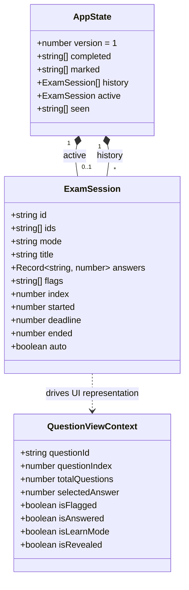
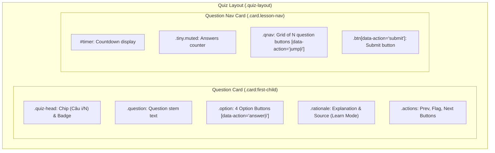
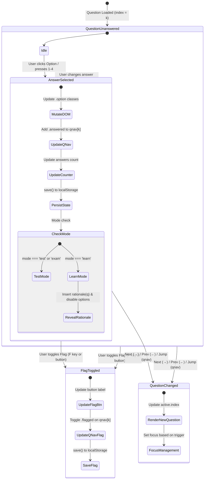

# Data Model & Interaction State: Improve DOM Rendering & Keyboard Accessibility

**Feature**: `specs/001-dom-rendering-accessibility`  
**Date**: 2026-11-03  
**Status**: Completed  

---

## 1. Domain Entities & In-Memory State

The application state format in `localStorage` under key `netstudy-atmmt-v1` remains strictly identical to maintain backward and forward schema compatibility.

### Entity Specifications

#### 1. `AppState` (In-Memory State `state`)
- `version`: Fixed integer (`1`).
- `completed`: Array of string keys (`"${chapterId}:${sectionId}"`).
- `marked`: Array of string question IDs (`"q-..."`).
- `history`: Array of past completed `ExamSession` objects.
- `active`: Current in-progress `ExamSession` or `null`.
- `seen`: Array of question IDs already encountered in previous exams.

#### 2. `ExamSession` (`state.active`)
- `id`: Timestamp string (e.g. `"1800000000000"`).
- `ids`: Ordered array of question IDs in this session (e.g. 40 items for exam).
- `mode`: `"learn"` | `"test"` | `"exam"`.
- `title`: Display title of session.
- `answers`: Key-value map of `{ [questionId]: optionIndex (0..3) }`.
- `flags`: Array of question IDs marked for review.
- `index`: Current active question index (`0 <= index < ids.length`).
- `started`: Milliseconds epoch.
- `deadline`: Milliseconds epoch (for `"exam"` mode) or `null`.

---

## 2. Targeted DOM Mapping & Selectors

The targeted updates interact with pre-existing or reliably queryable DOM elements:

### Element Update Mappings:

| User Action | Target Selector | Mutated Attributes / Properties | Notes |
|:---|:---|:---|:---|
| **Option Selected (`answer\|i`)** | `.option[data-action="answer\|${k}"]` | `classList.toggle('selected', k === i)` `setAttribute('aria-pressed', k === i)` | If `mode === 'learn'`: add `.right` to correct option, `.wrong` to selected option if incorrect; set `disabled=true` on all 4 options. |
| **Rationale Reveal (`mode === 'learn'`)** | `.rationale` / placeholder | Insert rendered `rationale(q)` HTML replacing the placeholder `
Đáp án chưa được công bố.
` | Triggered only once upon first answering in `learn` mode. |
| **QNav Answered Update** | `.qnav button[data-action="jump\|${index}"]` | `classList.add('answered')` | Target button index corresponds to `state.active.index`. |
| **Answered Counter Text** | `.lesson-nav p.tiny.muted` | `textContent = "${count}/${total} câu đã trả lời"` | `count = Object.keys(state.active.answers).length`. |
| **Flag Toggled (`flag`)** | `button[data-action="flag"]` | `textContent = isFlagged ? '★ Đã đánh dấu' : '☆ Đánh dấu xem lại'` | Toggles in place; focus remains on the button. |
| **QNav Flagged Update** | `.qnav button[data-action="jump\|${index}"]` | `classList.toggle('flagged', isFlagged)` | Target button index corresponds to `state.active.index`. |
| **Section Completed (`complete\|ch\|sec`)** | `button[data-action="complete\|${ch}\|${sec}"]` | `textContent = isDone ? '✓ Đã học mục này' : 'Đánh dấu đã học'` | Toggles in place on lesson section. |
| **Lesson Nav Link Check** | `.lesson-nav a[href*="#lesson/${ch}/${sec}"]` | Appends or removes `' ✓'` in link text | Updates corresponding link in lesson sidebar. |
| **Question Bookmarked (`mark\|qid`)** | `button[data-action="mark\|${qid}"]` | `textContent = isMarked ? '★ Bỏ đánh dấu' : '☆ Lưu câu này'` | In `result()` and `review()` views. |

---

## 3. Interaction State Machine (Quiz Mode)

