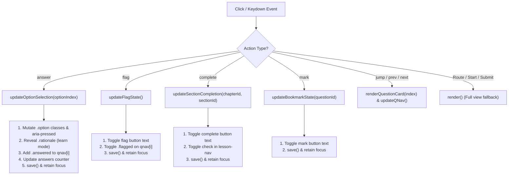

# Implementation Plan: Improve DOM Rendering & Keyboard Accessibility

**Branch**: `specs/001-dom-rendering-accessibility` | **Date**: 2026-11-03 | **Spec**: [specs/001-dom-rendering-accessibility/spec.md](spec.md)

**Input**: Feature specification from `specs/001-dom-rendering-accessibility/spec.md`

---

## Summary

This plan details the technical implementation for eliminating full-page DOM re-renders during in-quiz answer selection, review flagging, question bookmarking, and lesson section completion in NetStudy. By introducing targeted, localized DOM mutation helpers within `dist/app.js`, interactions will update only the specific affected buttons, explanations, and navigation indicators. This preserves the browser's native scroll position, eliminates layout shift (CLS = 0), retains keyboard focus (`document.activeElement`) for WCAG 2.2 AA accessibility, and adds non-intrusive keyboard shortcuts (1-4, A-D, Arrow keys) while preserving 100% of existing Vanilla JS architecture, exam algorithms, and automated test suite compatibility.

---

## Technical Context

**Language/Version**: Modern Vanilla JavaScript (ES2022+), HTML5, CSS3  
**Primary Dependencies**: None (Zero runtime dependencies; no npm packages in `dist/`)  
**Storage**: Client-side `localStorage` (key: `netstudy-atmmt-v1`)  
**Testing**: Node.js built-in `vm` test runners (`checks.cjs`, `checks-models.cjs`) + in-browser manual validation  
**Target Platform**: Modern standard browsers (Chrome, Edge, Firefox, Safari on desktop and mobile down to 320px)  
**Project Type**: Zero-dependency Client-side Single Page Application (SPA)  
**Performance Goals**: Sub-16ms DOM mutation latency (60 FPS response), Cumulative Layout Shift (CLS) = 0 during interaction  
**Constraints**: Zero runtime dependencies, 100% offline-first, strictly preserve existing examination matrix, seeds, and scoring algorithms  
**Scale/Scope**: 9 chapters, 95 sections, 264 questions, 27 interactive SVG models, 40-question / 75-minute exam sessions  

---

## Constitution Check

*GATE: Must pass before Phase 0 research. Re-checked after Phase 1 design.*

| Principle | Requirement | Assessment | Compliance |
|:---|:---|:---|:---:|
| **I. Vanilla-First Architecture** | Zero runtime framework, no npm packages in `dist/` | Solution uses pure native DOM APIs (`classList`, `setAttribute`, `querySelector`). No libraries added. | **PASS** |
| **II. Feature Preservation** | Preserve all 9 courses, 264 questions, 27 models, 40Q/75m exam, history | Targeted updates do not alter course content, models, question definitions, or grading modes. | **PASS** |
| **III. Deterministic Exam Engine** | Do not alter `makeExam`, seeds (`seeded(533)`), quotas, scoring | `core.js` is untouched. Exam matrix and scoring formulas remain invariant. | **PASS** |
| **IV. Local-First & Privacy** | Local-only persistence in `localStorage` (`netstudy-atmmt-v1`) | State mutation still calls `save()` directly to `localStorage`. Zero telemetry or network requests. | **PASS** |
| **V. UI/UX Pro Max Standard** | Systematic design tokens, clear contrast, accessible micro-interactions | Focus rings satisfy $\ge 3:1$ contrast (`:focus-visible`), interactive states provide smooth feedback. | **PASS** |
| **VI. Accessibility (WCAG 2.2 AA)** | Keyboard navigation, focus retention, mobile responsive | Eliminates focus dropping to `<body>`. Retains focus on active elements. Adds keyboard shortcuts. | **PASS** |
| **VII. Zero-Dependency & Security** | Strict XSS sanitization, schema validation, zero-npm | No string concatenation without existing escape helpers. All updates manipulate existing safe DOM nodes. | **PASS** |
| **VIII. Mandatory Testing** | All tests in `checks.cjs` and `checks-models.cjs` must pass | `render()` remains fully functional for full view transitions, ensuring 100% pass rate in headless tests. | **PASS** |
| **IX. Spec-Driven Development** | Follow SDD lifecycle (Spec $\rightarrow$ Plan $\rightarrow$ Tasks $\rightarrow$ Implement) | Current stage is Plan. Tasks and Implementation will proceed sequentially under user approval. | **PASS** |
| **X. Controlled Git Operations** | No unauthorized commits, pushes, merges, or deployments | Strictly adheres to planning documentation only. No git commit or deploy executed. | **PASS** |

---

## Project Structure

### Documentation (this feature)

```text
specs/001-dom-rendering-accessibility/
├── spec.md              # Feature specification & requirements
├── plan.md              # This technical implementation plan
├── research.md          # Technical research & architectural decisions (Phase 0)
├── data-model.md        # State entities & targeted DOM mapping (Phase 1)
├── quickstart.md        # Verification scenarios & testing commands (Phase 1)
├── contracts/           # Interaction & event contracts (Phase 1)
│   └── ui-interaction-contract.md
├── checklists/
│   └── requirements.md  # Specification quality checklist
└── tasks.md             # Sequenced task breakdown (generated by /speckit-tasks)
```

### Source Code Layout

```text
dist/
├── index.html           # Unaltered shell
├── style.css            # Focus-visible styles
├── core.js              # Unaltered domain logic & exam generation
├── models.js            # Unaltered 27 visual models data
├── model-ui.js          # Unaltered SVG renderer
├── data.js              # Generated course content
└── app.js               # PRIMARY MODIFICATION TARGET (Targeted DOM updates & keyboard navigation)

checks.cjs               # Automated headless regression test harness
checks-models.cjs        # Automated models & cryptographic verification test harness
assemble.py              # Curriculum pre-compiler
build-models.py          # Visual models pre-compiler
```

---

## 1. Architectural Analysis of Current Implementation

### 1.1 `render()` Call Sites & DOM Replacement
Inspection of `dist/app.js` reveals `render()` is invoked in the following locations:
1. **Route dispatcher**: `go(path)` (line 12), `window.hashchange` (line 36), and initial script boot.
2. **Settings import**: `settings()` file upload callback (line 33).
3. **Event delegation listener**: `app.addEventListener('click', ev => ...)` (line 35):
   - `case 'complete'`: `state.completed = ...; save(); const y=scrollY; render(); scrollTo(0,y);`
   - `case 'answer'`: `a.answers[q.id]=Number(args[0]); save(); const y=scrollY; render(); scrollTo(0,y);`
   - `case 'flag'`: `a.flags = ...; save(); render();` (Notice: no scroll saving!)
   - `case 'mark'`: `state.marked = ...; save(); const y=scrollY; render(); scrollTo(0,y);`
   - `case 'jump'`, `case 'prev'`, `case 'next'`: `a.index = ...; save(); render();`
4. **Timer auto-submission**: `updateTimer()` and visibility/focus handlers calling `submit(true)`.

### 1.2 State Management & Event Handlers
- **State Store**: A single global object `let state = C.fresh()` synchronized to `localStorage` via `save()`.
- **Event Handling**: A single delegated click listener on `app` handles all button interactions via `dataset.action`.
- **Re-render Mechanism**: `render()` evaluates `route`, renders the whole view into a template string, and sets `app.innerHTML = ...`. This completely destroys the old DOM tree.

### 1.3 Focus & Scroll Dependencies
- When `app.innerHTML` is replaced, `document.activeElement` is detached from the DOM, causing focus to drop to `<body>`. Screen readers lose reading context, and keyboard Tab navigation restarts from the top of the page.
- The `const y=scrollY; render(); scrollTo(0,y);` workaround forces synchronous reflows, causing visual flicker and occasional scroll jitter when content height varies slightly.

### 1.4 Risks to Active Exams, Timer & LocalStorage
- **Exam Timer**: Currently, every answer click triggers `render()`, which calls `clearInterval(tick)` and recreates the timer in `session()`. This constant tear-down and rebuild causes timer stutter.
- **Auto-Submission**: If the user is on the last question when deadline arrives, `submit(true)` must still be invoked immediately.
- **Storage Integrity**: Targeted updates must never forget to invoke `save()`, ensuring `localStorage` remains 100% up-to-date in case the user closes the tab immediately after clicking an option.

---

## 2. Technical Solution Design

### 2.1 Proposed Architecture: Surgical DOM Updates
Instead of replacing `app.innerHTML`, four granular helper functions will be introduced in `dist/app.js` to handle in-place mutations:



### 2.2 Trade-Off Analysis & Lowest-Risk Justification

| Approach | Complexity | Risk to Existing Logic | Headless Test Compatibility | Verdict |
|:---|:---:|:---:|:---:|:---:|
| **1. Full Virtual DOM Rewrite** | High | Extreme (could break `checks.cjs` DOM mock) | Poor (requires synthetic DOM tree) | Rejected |
| **2. Reactive Proxy / Signal System** | High | Moderate (invasive changes to state access) | Moderate | Rejected |
| **3. Targeted DOM Mutation Helpers** | Low | Low (only touches click dispatch branches) | 100% compatible (full `render()` preserved) | **Selected** |

**Why Approach 3 is Lowest Risk**:
1. `render()` is retained completely intact. When routes change (`#home` $\rightarrow$ `#exam` $\rightarrow$ `#result`), full rendering functions exactly as before.
2. In-memory state transformations (`state.active.answers[...] = ...; save();`) remain strictly identical.
3. Automated headless tests in `checks.cjs` (which call `render()`) continue to pass without any test file modifications.
4. The timer interval is no longer torn down on every click, improving timer stability.

---

## 3. Testing Strategy

### 3.1 Headless Automated Tests (Node.js)
Run existing test runners to ensure 0 regression:
1. `node checks.cjs`: Verifies schema, routes, 100 randomized exam generations, scoring accuracy, answer visibility, deadline expiry, and backup validation.
2. `node checks-models.cjs`: Verifies 27 models, 112 steps, chapter filtering, and numeric cryptographic proofs (RSA, DH, OTP).

### 3.2 Real-Browser Verification Test Matrix
The following capabilities MUST be tested directly in a browser (e.g. Chrome / Firefox / Edge via `py -m http.server 8000`):

| Test Case | Interaction Method | Expected Outcome | Verification Tool |
|:---|:---|:---|:---|
| **TC-01: Focus Retention on Option Click** | Mouse click on Option B | Option B selected; `:focus-visible` stays on Option B; `activeElement === optionB` | DevTools Console: `document.activeElement` |
| **TC-02: Focus Retention on Keyboard Select** | Tab to Option C, press `Space` | Option C selected; focus remains on Option C | Visual focus ring + screen reader |
| **TC-03: Zero Scroll Jitter** | Scroll question to center, select Option D | Scroll position does not deviate by even 1px; no `scrollTo` executed | Console log `window.scrollY` before and after |
| **TC-04: Flag Toggle In-Place** | Press `F` or click Flag button | Label toggles; `qnav` button updates; no scroll or focus loss | Visual check |
| **TC-05: Keyboard Shortcut Question Navigation** | Press `ArrowRight` / `ArrowLeft` | Question changes; focus moves to new question container | Keyboard-only test |
| **TC-06: Exam Timer Continuous Countdown** | Rapidly answer 10 questions in exam | Timer counts down second-by-second without pausing or restarting | Visual check on `#timer` |
| **TC-07: LocalStorage Persistence** | Answer 5 questions, press `F5` (reload) | All 5 answers and active question index restored accurately | Check `localStorage['netstudy-atmmt-v1']` |
| **TC-08: Lesson Section Completion** | Click "Đánh dấu đã học" in Lesson 3.4 | Button updates; right-hand nav displays `✓`; 0px scroll jump | Visual check in `#lesson/3` |

---

## 4. Implementation Slices (Incremental & Independently Reversible)

### Slice 1: Targeted Quiz Option Selection (`dist/app.js`)
- **File**: `dist/app.js`
- **Purpose**: Implement `updateOptionSelection(optionIndex)` in `app.js` under `case 'answer'`.
  - Mutate `.option` classes (`.selected`, and in `learn` mode: `.right`, `.wrong`, `disabled`).
  - Reveal or insert `.rationale` block when in `learn` mode.
  - Update `.answered` on `qnav button[data-action="jump|${index}"]`.
  - Update answered counter string.
  - Call `save()`.
  - Maintain focus on the clicked/selected option button.
  - Remove `const y=scrollY; render(); scrollTo(0,y);`.
- **Risk**: Missing rationale insertion in `learn` mode or failing to disable options after answering in `learn` mode.
- **Testing**: Run `node checks.cjs`; verify in browser across `learn`, `test`, and `exam` modes.
- **Acceptance Criteria**: Selecting options updates the card instantly with zero layout shift, zero scroll jump, and focus remains on the option.

### Slice 2: Targeted Flag Toggle (`dist/app.js`)
- **File**: `dist/app.js`
- **Purpose**: Implement `updateFlagState()` under `case 'flag'`.
  - Toggle `id` in `a.flags`.
  - Call `save()`.
  - Update flag button label (`★ Đã đánh dấu` $\leftrightarrow$ `☆ Đánh dấu xem lại`).
  - Toggle `.flagged` on `qnav button[data-action="jump|${index}"]`.
  - Maintain focus on the flag button.
  - Remove `render();`.
- **Risk**: Desynchronization between `a.flags` and `qnav` button styling.
- **Testing**: Flag and unflag questions in exam mode; reload page to verify state persisted in `localStorage`.
- **Acceptance Criteria**: Flag toggles with 0 scroll jump and zero focus loss.

### Slice 3: Targeted Section Completion & Bookmark Toggle (`dist/app.js`)
- **File**: `dist/app.js`
- **Purpose**: Implement targeted updates for `case 'complete'` and `case 'mark'`.
  - In `complete`: toggle key in `state.completed`, call `save()`, toggle button label (`✓ Đã học mục này` $\leftrightarrow$ `Đánh dấu đã học`), toggle `✓` in `.lesson-nav` sidebar link. Remove `render()`.
  - In `mark`: toggle `qid` in `state.marked`, call `save()`, toggle button label (`★ Bỏ đánh dấu` $\leftrightarrow$ `☆ Lưu câu này`). Remove `render()`.
- **Risk**: Sidebar link selector mismatch for section IDs with dots/special characters.
- **Testing**: Test completion in Lessons 1, 2a, 3, 8; test bookmarks in `#review` and `#result`.
- **Acceptance Criteria**: Completion and bookmarks toggle in-place with zero scroll jitter.

### Slice 4: Context-Aware Keyboard Shortcut Manager (`dist/app.js`)
- **File**: `dist/app.js`
- **Purpose**: Add a guarded `keydown` event listener to `document`:
  - Guard: only active when `route === 'session'` and `activeElement` is not an input/textarea/select.
  - Keys `1`-`4` or `A`-`D`: trigger `updateOptionSelection(0..3)`.
  - Keys `ArrowRight` / `N`: trigger next question.
  - Keys `ArrowLeft` / `P`: trigger previous question.
  - Key `F`: trigger flag toggle.
- **Risk**: Keystroke interception during text search in other views.
- **Testing**: Verify shortcuts work in quiz session; verify shortcuts are disabled when typing in `#courseSearch` or `#termSearch`.
- **Acceptance Criteria**: Entire 40-question exam can be completed and reviewed via keyboard only.

### Slice 5: Regression & Accessibility Verification
- **Files**: `dist/app.js`, `dist/style.css` (only if `:focus-visible` styling needs minor contrast refinement)
- **Purpose**: Run full validation suite (`assemble.py`, `build-models.py`, `node --check`, `checks.cjs`, `checks-models.cjs`) and verify WCAG 2.2 AA focus indicators.
- **Risk**: Subtle edge case in test harness DOM mock.
- **Testing**: Full test suite execution + Lighthouse / Accessibility audit in browser.
- **Acceptance Criteria**: 100% test pass rate, CLS = 0, zero focus drops.
