# Tasks: Improve DOM Rendering & Keyboard Accessibility

**Input**: Design documents from `specs/001-dom-rendering-accessibility/` (`spec.md`, `plan.md`, `research.md`, `data-model.md`, `contracts/ui-interaction-contract.md`, `quickstart.md`)  
**Prerequisites**: `plan.md`, `spec.md`, `constitution.md` (v1.0.0 ratified)  
**Organization**: Tasks are grouped by foundational phase and user stories to enable incremental, independently verifiable delivery.

---

## Task Format Reference
`- [ ] [ID] [P?] [Story?] Description with file path`
- **[P]**: Parallelizable (different files, no shared state conflicts)
- **[Story]**: Mapped User Story (`[US1]`, `[US2]`, `[US3]`, `[US4]`)

---

## Phase 1: Setup & Baseline Regression (Nhóm A & D Prerequisites)

**Purpose**: Establish a verifiable baseline of existing functionality, test harnesses, and state invariants before touching application code.

- [x] T001 Execute baseline test suite to verify 100% PASS on `checks.cjs` and `checks-models.cjs`
- [x] T002 [P] Record baseline scroll and layout metrics in `specs/001-dom-rendering-accessibility/quickstart.md`
- [x] T003 Verify `localStorage` schema invariants (`netstudy-atmmt-v1`) in `dist/core.js` and `dist/app.js`

---

## Phase 2: Foundational Targeted DOM & Focus Helpers (Nhóm B & C Infrastructure)

**Purpose**: Core helper infrastructure in `dist/app.js` that MUST be complete before user story mutation branches can be wired up.

- [x] T004 Implement `safeFocus(element, preventScroll)` helper in `dist/app.js` to retain focus without triggering scroll jumps
- [x] T005 Implement targeted element selector and class toggle utilities in `dist/app.js` for quiz components (`.option`, `.qnav button`, `.rationale`)

**Checkpoint**: Foundation ready — User Story 1 (MVP) implementation can begin.

---

## Phase 3: User Story 1 - Targeted Option Selection (Priority: P1) 🎯 MVP (Nhóm B & C)

**Goal**: Enable in-place answer selection in quiz/exam screens without full-page `innerHTML` replacement, eliminating layout shift and retaining active option focus.  
**Independent Test**: In a practice session, click options A, B, C, D: button states toggle instantly, `qnav` button turns green (`answered`), counter updates, focus stays on the clicked option, and `window.scrollY` remains 100% stable.

- [x] T006 [US1] Implement `updateOptionSelection(optionIndex)` in `dist/app.js` to mutate `.option` classes (`.selected`, `aria-pressed`)
- [x] T007 [US1] Implement `learn` mode rationale insertion and option disabling (`disabled=true`) in `updateOptionSelection` in `dist/app.js`
- [x] T008 [US1] Update `qnav` answered indicator and answered counter text in `dist/app.js` within `updateOptionSelection`
- [x] T009 [US1] Wire `case 'answer'` in `dist/app.js` to call `updateOptionSelection` and `save()`, removing `const y=scrollY; render(); scrollTo(0,y);`
- [x] T010 [US1] Verify `checks.cjs` regression tests continue to pass with updated `case 'answer'` in `dist/app.js`

**Checkpoint**: User Story 1 is fully functional and independently testable (MVP complete).

---

## Phase 4: User Story 2 - Targeted Flag & Bookmark Toggling (Priority: P1) (Nhóm B & C)

**Goal**: In-place review flagging in exams and bookmarking in results/review without screen jumps or focus drops.  
**Independent Test**: Scroll down in an exam question, click "☆ Đánh dấu xem lại": label toggles to "★ Đã đánh dấu", `qnav` item gains yellow flag border, scroll position does not move 1px, and focus remains on the flag button.

- [x] T011 [US2] Implement `updateFlagState()` in `dist/app.js` to toggle flag button label and `qnav` button `.flagged` class
- [x] T012 [US2] Wire `case 'flag'` in `dist/app.js` to call `updateFlagState()` and `save()`, removing `render()`
- [x] T013 [US2] Implement targeted bookmark update in `case 'mark'` in `dist/app.js` to toggle label between `'☆ Lưu câu này'` and `'★ Bỏ đánh dấu'` without `render()`
- [x] T014 [US2] Verify `checks.cjs` regression tests continue to pass with updated `case 'flag'` and `case 'mark'` in `dist/app.js`

**Checkpoint**: User Stories 1 AND 2 are functional, eliminating 95% of in-exam re-renders.

---

## Phase 5: User Story 3 - Lesson Section Completion (Priority: P2) (Nhóm B & C)

**Goal**: In-place completion tracking in long lesson views without re-rendering the entire course article.  
**Independent Test**: In Lesson 3, scroll to Section 3.4 and click "Đánh dấu đã học": button updates to "✓ Đã học mục này", sidebar link gains "✓", scroll position stays completely still.

- [x] T015 [US3] Implement `updateSectionCompletion(chapterId, sectionId)` in `dist/app.js` to toggle button text and `.lesson-nav` checkmark
- [x] T016 [US3] Wire `case 'complete'` in `dist/app.js` to call `updateSectionCompletion` and `save()`, removing `const y=scrollY; render(); scrollTo(0,y);`
- [x] T017 [US3] Verify lesson navigation and progress percentages remain accurate after targeted completion in `dist/app.js`

**Checkpoint**: User Stories 1, 2, and 3 work seamlessly and independently.

---

## Phase 6: User Story 4 - Keyboard Navigation & Accessibility (Priority: P2) (Nhóm C)

**Goal**: Provide context-aware keyboard shortcuts (1-4, A-D, Arrow keys, F) and purposeful focus transitions when changing questions, achieving WCAG 2.2 AA accessibility.  
**Independent Test**: Complete an entire 40-question mock exam using only keyboard (`1`-`4`, `ArrowRight`, `F`, `Enter`) with zero mouse interaction.

- [x] T018 [US4] Implement context-aware `keydown` listener on `document` in `dist/app.js` with guards for route `session` and active text inputs
- [x] T019 [US4] Map keys `1`-`4` and `A`-`D` to `updateOptionSelection(0..3)` and key `F` to `updateFlagState()` in `dist/app.js`
- [x] T020 [US4] Map keys `ArrowRight`/`N` to next question and `ArrowLeft`/`P` to previous question in `dist/app.js`
- [x] T021 [US4] Implement intelligent focus placement in `case 'jump'`, `case 'next'`, `case 'prev'` in `dist/app.js`
- [x] T022 [P] [US4] Audit and refine `:focus-visible` styling in `dist/style.css` to guarantee contrast ratio $\ge 3:1$ against background

**Checkpoint**: Full keyboard accessibility achieved with zero mouse dependency.

---

## Phase 7: Polish, State Persistence & Verification (Nhóm D & E)

**Purpose**: Cross-cutting verification of exam timers, reload persistence, regression test suites, and in-browser matrix validation.

- [x] T023 Verify exam timer continuity and auto-submission on timeout in `dist/app.js` during rapid option selection
- [x] T024 Verify state reload (`F5`) persistence of active answers, flags, and completed sections in `localStorage`
- [x] T025 Execute automated syntax check via `node --check dist/app.js` and `node --check dist/core.js`
- [x] T026 Execute automated regression test suite via `node checks.cjs` and `node checks-models.cjs`
- [x] T027 Run manual in-browser validation scenarios A through E from `quickstart.md`
- [x] T028 Document final verification results and any unverified browser edge cases in `specs/001-dom-rendering-accessibility/quickstart.md`

---

## Dependencies & Execution Order

```mermaid
flowchart TD
    subgraph P1 ["Phase 1: Setup & Baseline"]
        T001["T001: Run baseline checks"]
        T002["T002: Record baseline metrics"]
        T003["T003: Verify localStorage schema"]
    end

    subgraph P2 ["Phase 2: Foundation"]
        T004["T004: safeFocus helper"]
        T005["T005: Selector & toggle helpers"]
    end

    subgraph P3 ["Phase 3: User Story 1 (MVP)"]
        T006["T006: updateOptionSelection classes"]
        T007["T007: Learn mode rationale & disable"]
        T008["T008: qnav & counter update"]
        T009["T009: Wire case 'answer' in app.js"]
        T010["T010: Verify checks.cjs PASS"]
    end

    subgraph P4 ["Phase 4: User Story 2"]
        T011["T011: updateFlagState helper"]
        T012["T012: Wire case 'flag' in app.js"]
        T013["T013: Wire case 'mark' in app.js"]
        T014["T014: Verify checks.cjs PASS"]
    end

    subgraph P5 ["Phase 5: User Story 3"]
        T015["T015: updateSectionCompletion helper"]
        T016["T016: Wire case 'complete' in app.js"]
        T017["T017: Verify lesson nav sync"]
    end

    subgraph P6 ["Phase 6: User Story 4"]
        T018["T018: Guarded keydown listener"]
        T019["T019: Keys 1-4/A-D/F mapping"]
        T020["T020: Arrow keys navigation"]
        T021["T021: Intelligent focus transfer"]
        T022["T022: :focus-visible CSS audit"]
    end

    subgraph P7 ["Phase 7: Polish & Verification"]
        T023["T023: Timer continuity check"]
        T024["T024: Reload persistence check"]
        T025["T025: Syntax check"]
        T026["T026: Run checks.cjs & checks-models.cjs"]
        T027["T027: Browser manual validation"]
        T028["T028: Document verification report"]
    end

    P1 --> P2
    P2 --> P3
    P3 --> P4
    P4 --> P5
    P5 --> P6
    P6 --> P7
```

---

## Parallel Execution Opportunities

- **Phase 1**: T001, T002, T003 can execute in parallel.
- **Phase 2**: T004 and T005 can execute in parallel.
- **Phase 6**: T022 (`dist/style.css`) can execute in parallel with T018-T021 (`dist/app.js`).
- **Phase 7**: T025 and T026 can run in parallel with manual test preparations.

---

## Implementation Strategy: MVP First

1. **Step 1 (Baseline)**: Complete Phase 1 and Phase 2. Confirm baseline checks pass.
2. **Step 2 (MVP Delivery)**: Implement Phase 3 (User Story 1 - Option Selection).
   - *Validation*: Test selecting answers in practice and exam modes. Confirm zero layout shift, zero scroll jitter, focus retained. Run `checks.cjs`.
3. **Step 3 (Review Enhancements)**: Implement Phase 4 (User Story 2 - Flag & Bookmark).
   - *Validation*: Test flagging questions. Confirm yellow border on `qnav` and zero scroll jump.
4. **Step 4 (Lesson Polish)**: Implement Phase 5 (User Story 3 - Section Completion).
   - *Validation*: Test marking sections completed in Lesson 3.
5. **Step 5 (Accessibility & Shortcuts)**: Implement Phase 6 (User Story 4 - Keyboard Navigation).
   - *Validation*: Complete a full exam using keyboard only.
6. **Step 6 (Full Verification)**: Complete Phase 7. All automated tests pass 100%. Manual browser matrix confirmed.
