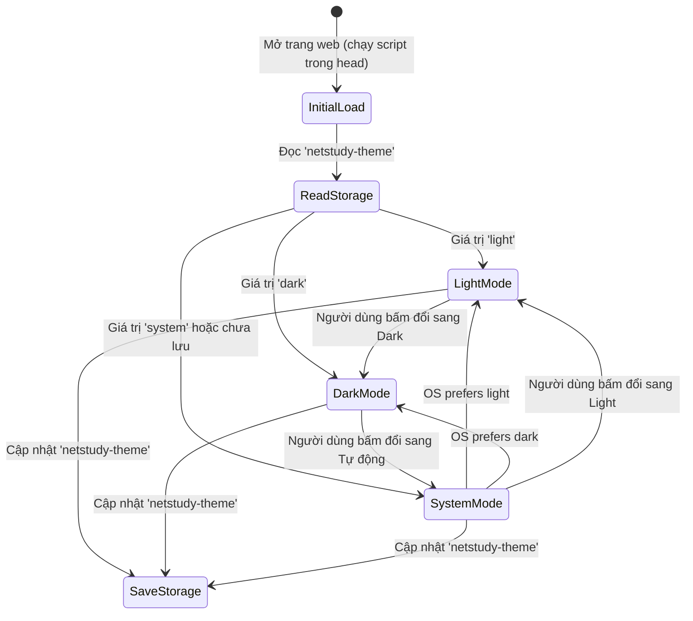

# Data Model & Token Architecture: NetStudy UI/UX Design System

**Feature**: `specs/002-ui-ux-design-system`
**Date**: 2026-11-04
**Status**: Completed

---

## 1. Theme Configuration Entity (`ThemeState`)

Thực thể quản lý trạng thái giao diện của người dùng. Tách biệt hoàn toàn khỏi dữ liệu học tập trong `localStorage` để đảm bảo tính an toàn dữ liệu (Constitution Principle IV).

### Schema Definition

| Thuộc tính (Property) | Kiểu dữ liệu (Type) | Giá trị hợp lệ (Valid Values) | Mặc định (Default) | Lưu trữ (Storage) | Mô tả |
|:---|:---|:---|:---|:---|:---|
| `mode` | `string` | `'light' \| 'dark' \| 'system'` | `'system'` | `localStorage.getItem('netstudy-theme')` | Tùy chọn giao diện người dùng thiết lập chủ động. |
| `resolved` | `string` | `'light' \| 'dark'` | Tự động tính | `document.documentElement.dataset.theme` | Giá trị thực tế áp dụng lên DOM sau khi phân giải qua media query. |

### Validation & Parsing Rule

```javascript
function resolveTheme(preference) {
  if (preference === 'dark') return 'dark';
  if (preference === 'light') return 'light';
  // Default 'system': check OS media query
  return window.matchMedia?.('(prefers-color-scheme: dark)').matches ? 'dark' : 'light';
}
```

### State Transitions



---

## 2. Design Token Hierarchy (3-Tier Token Registry)

Kiến trúc biến CSS 3 tầng tuân thủ chuẩn **UI UX Pro Max & Design System**:

```text
[Tier 1: Primitive Tokens] ──> [Tier 2: Semantic Tokens] ──> [Tier 3: Component Tokens]
   (Mã màu thô, cỡ px)           (Ngữ nghĩa giao diện, theme)    (Nút, thẻ, thanh điều hướng)
```

### Tier 1 — Primitive Tokens (Khai báo tĩnh tại `:root`)

#### 1. Color Primitives
```css
/* Emerald Palette (Nhận diện an toàn bảo mật) */
--emerald-50:  #f0fdf4;
--emerald-100: #dcfce7;
--emerald-200: #bbf7d0;
--emerald-300: #86efac;
--emerald-400: #4ade80;
--emerald-500: #22c55e;
--emerald-600: #16a34a;
--emerald-700: #15803d;
--emerald-800: #166534;
--emerald-900: #14532d;
--emerald-950: #052e16;

/* Slate / Dark Cipher Palette (Nền tối và văn bản) */
--slate-50:  #f8fafc;
--slate-100: #f1f5f9;
--slate-200: #e2e8f0;
--slate-300: #cbd5e1;
--slate-400: #94a3b8;
--slate-500: #64748b;
--slate-600: #475569;
--slate-700: #334155;
--slate-800: #1e293b;
--slate-900: #0f172a;
--slate-950: #020617;

/* Semantic Status Primitives */
--red-500:   #ef4444;
--red-600:   #dc2626;
--amber-500: #f59e0b;
--amber-600: #d97706;
```

#### 2. Spacing Scale
```css
--space-1: 0.25rem;  /* 4px */
--space-2: 0.5rem;   /* 8px */
--space-3: 0.75rem;  /* 12px */
--space-4: 1rem;     /* 16px */
--space-5: 1.25rem;  /* 20px */
--space-6: 1.5rem;   /* 24px */
--space-8: 2rem;     /* 32px */
--space-10: 2.5rem;  /* 40px */
--space-12: 3rem;    /* 48px */
```

#### 3. Border Radius
```css
--radius-xs: 4px;
--radius-sm: 6px;
--radius-md: 8px;
--radius-lg: 12px;
--radius-xl: 16px;
--radius-full: 9999px;
```

#### 4. Typography Scale
```css
--font-sans: 'Be Vietnam Pro', system-ui, -apple-system, sans-serif;
--font-mono: ui-monospace, 'SF Mono', 'Cascadia Code', 'JetBrains Mono', monospace;
--text-xs: 0.75rem;    /* 12px */
--text-sm: 0.8125rem;  /* 13px */
--text-base: 0.875rem; /* 14px */
--text-md: 1rem;       /* 16px */
--text-lg: 1.25rem;    /* 20px */
--text-xl: 1.5rem;     /* 24px */
--text-2xl: 1.875rem;  /* 30px */
--text-3xl: 2.25rem;   /* 36px */
```

---

### Tier 2 — Semantic Tokens (Ánh xạ động theo Theme)

| Token Ngữ Nghĩa | Light Mode (`:root`) | Dark Mode (`[data-theme="dark"]`) | Tương phản WCAG |
|:---|:---|:---|:---:|
| `--bg-canvas` | `#F8FAF8` (Clean Paper) | `#0D1514` (Deep Cipher Slate) | Nền chính |
| `--bg-surface` | `#FFFFFF` | `#152220` | Khối thẻ card |
| `--bg-surface-elevated`| `#F0F4F1` | `#1D2E2B` | Thanh header/sidebar |
| `--bg-subtle` | `#EDF4EF` | `#172824` | Khối ghi chú/code block |
| `--text-primary` | `#112320` | `#EDF4F1` | $\ge 13:1$ (Đạt AAA) |
| `--text-secondary` | `#334641` | `#BDCEC7` | $\ge 7:1$ (Đạt AAA) |
| `--text-muted` | `#4B5E59` | `#9DB2AA` | $\ge 5.2:1$ (Đạt AA) |
| `--border-default` | `#D8E2D9` | `rgba(74, 110, 98, 0.35)` | $\ge 3:1$ |
| `--border-focus` | `#15634F` | `#2AD586` | $\ge 3.5:1$ (Đạt AA) |
| `--accent-primary` | `#15634F` (Forest Emerald) | `#2AD586` (Neon Emerald) | Nhận diện thương hiệu |
| `--status-success-bg` | `#EDF6EE` | `#132E22` | Nền đáp án đúng |
| `--status-success-text`| `#15803D` | `#4ADE80` | $\ge 4.5:1$ |
| `--status-error-bg` | `#FFF0ED` | `#321816` | Nền đáp án sai |
| `--status-error-text` | `#B91C1C` | `#F87171` | $\ge 4.5:1$ |
| `--status-flag-color` | `#D97706` | `#FBBF24` | Cờ xem lại |

---

### Tier 3 — Component Tokens (Quy chuẩn Thành phần Giao diện)

#### Quiz & Exam Components
- `--quiz-option-bg`: `var(--bg-surface)`
- `--quiz-option-border`: `var(--border-default)`
- `--quiz-option-bg-hover`: `var(--bg-subtle)`
- `--quiz-option-selected-bg`: `var(--emerald-50)` (Light) / `#163328` (Dark)
- `--quiz-option-selected-border`: `var(--accent-primary)`
- `--qnav-btn-size`: `34px`
- `--qnav-answered-bg`: `var(--status-success-bg)`
- `--qnav-flagged-border`: `var(--status-flag-color)`
- `--timer-urgent`: `var(--status-error-text)`

#### Layout & Navigation Components
- `--sidebar-width`: `242px`
- `--sidebar-width-tablet`: `205px`
- `--header-height`: `64px`
- `--mobile-bottom-bar-height`: `60px`
- `--touch-target-min`: `44px`

---

## 3. SVG Icon System Catalog Entity (`SvgIconCatalog`)

Tập hợp các vector icon được lưu trữ dưới dạng hàm sinh chuỗi SVG trong bộ nhớ JS:

```javascript
const ICONS = {
  home: '<path d="M3 9l9-7 9 7v11a2 2 0 0 1-2 2H5a2 2 0 0 1-2-2z"/><polyline points="9 22 9 12 15 12 15 22"/>',
  book: '<path d="M4 19.5A2.5 2.5 0 0 1 6.5 17H20"/><path d="M6.5 2H20v20H6.5A2.5 2.5 0 0 1 4 19.5v-15A2.5 2.5 0 0 1 6.5 2z"/>',
  term: '<path d="M14 2H6a2 2 0 0 0-2 2v16a2 2 0 0 0 2 2h12a2 2 0 0 0 2-2V8z"/><polyline points="14 2 14 8 20 8"/><line x1="16" y1="13" x2="8" y2="13"/><line x1="16" y1="17" x2="8" y2="17"/><polyline points="10 9 9 9 8 9"/>',
  model: '<rect x="2" y="2" width="20" height="8" rx="2" ry="2"/><rect x="2" y="14" width="20" height="8" rx="2" ry="2"/><line x1="6" y1="6" x2="6.01" y2="6"/><line x1="6" y1="18" x2="6.01" y2="18"/>',
  practice: '<path d="M12 20h9"/><path d="M16.5 3.5a2.121 2.121 0 0 1 3 3L7 19l-4 1 1-4L16.5 3.5z"/>',
  exam: '<circle cx="12" cy="12" r="10"/><polyline points="12 6 12 12 16 14"/>',
  notebook: '<path d="M2 3h6a4 4 0 0 1 4 4v14a3 3 0 0 0-3-3H2z"/><path d="M22 3h-6a4 4 0 0 0-4 4v14a3 3 0 0 1 3-3h7z"/>',
  history: '<circle cx="12" cy="12" r="10"/><polyline points="12 6 12 12 8 14"/>',
  sources: '<path d="M21.44 11.05l-9.19 9.19a6 6 0 0 1-8.49-8.49l9.19-9.19a4 4 0 0 1 5.66 5.66l-9.2 9.19a2 2 0 0 1-2.83-2.83l8.49-8.48"/>',
  settings: '<circle cx="12" cy="12" r="3"/><path d="M19.4 15a1.65 1.65 0 0 0 .33 1.82l.06.06a2 2 0 0 1 0 2.83 2 2 0 0 1-2.83 0l-.06-.06a1.65 1.65 0 0 0-1.82-.33 1.65 1.65 0 0 0-1 1.51V21a2 2 0 0 1-2 2 2 2 0 0 1-2-2v-.09A1.65 1.65 0 0 0 9 19.4a1.65 1.65 0 0 0-1.82.33l-.06.06a2 2 0 0 1-2.83 0 2 2 0 0 1 0-2.83l.06-.06a1.65 1.65 0 0 0 .33-1.82 1.65 1.65 0 0 0-1.51-1H3a2 2 0 0 1-2-2 2 2 0 0 1 2-2h.09A1.65 1.65 0 0 0 4.6 9a1.65 1.65 0 0 0-.33-1.82l-.06-.06a2 2 0 0 1 0-2.83 2 2 0 0 1 2.83 0l.06.06a1.65 1.65 0 0 0 1.82.33H9a1.65 1.65 0 0 0 1-1.51V3a2 2 0 0 1 2-2 2 2 0 0 1 2 2v.09a1.65 1.65 0 0 0 1 1.51 1.65 1.65 0 0 0 1.82-.33l.06-.06a2 2 0 0 1 2.83 0 2 2 0 0 1 0 2.83l-.06.06a1.65 1.65 0 0 0-.33 1.82V9a1.65 1.65 0 0 0 1.51 1H21a2 2 0 0 1 2 2 2 2 0 0 1-2 2h-.09a1.65 1.65 0 0 0-1.51 1z"/>',
  sun: '<circle cx="12" cy="12" r="5"/><line x1="12" y1="1" x2="12" y2="3"/><line x1="12" y1="21" x2="12" y2="23"/><line x1="4.22" y1="4.22" x2="5.64" y2="5.64"/><line x1="18.36" y1="18.36" x2="19.78" y2="19.78"/><line x1="1" y1="12" x2="3" y2="12"/><line x1="21" y1="12" x2="23" y2="12"/><line x1="4.22" y1="19.78" x2="5.64" y2="18.36"/><line x1="18.36" y1="5.64" x2="19.78" y2="4.22"/>',
  moon: '<path d="M21 12.79A9 9 0 1 1 11.21 3 7 7 0 0 0 21 12.79z"/>',
  star: '<polygon points="12 2 15.09 8.26 22 9.27 17 14.14 18.18 21.02 12 17.77 5.82 21.02 7 14.14 2 9.27 8.91 8.26 12 2"/>',
  check: '<polyline points="20 6 9 17 4 12"/>',
  menu: '<line x1="3" y1="12" x2="21" y2="12"/><line x1="3" y1="6" x2="21" y2="6"/><line x1="3" y1="18" x2="21" y2="18"/>',
  close: '<line x1="18" y1="6" x2="6" y2="18"/><line x1="6" y1="6" x2="18" y2="18"/>'
};
```
