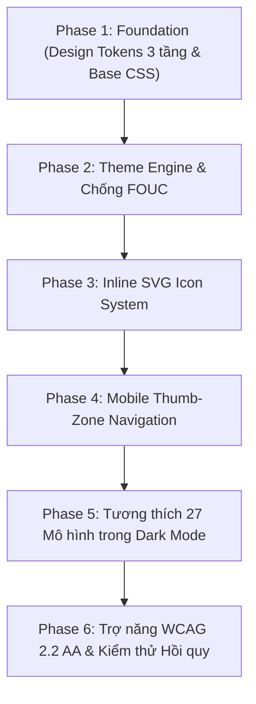

# Implementation Plan: NetStudy UI/UX Design System & Theme Engine

**Feature**: `specs/002-ui-ux-design-system`
**Branch**: `feat/002-ui-ux-design-system`
**Date**: 2026-11-04
**Spec**: [specs/002-ui-ux-design-system/spec.md](file:///d:/TIENDAT2024-2025/netstudy-network-security/specs/002-ui-ux-design-system/spec.md)
**Status**: Ready for Tasks Breakdown

---

## 1. Summary

Nâng cấp toàn diện trải nghiệm giao diện (UI/UX) cho NetStudy theo chuẩn **UI UX Pro Max** cho chủ đề Giáo dục An toàn mạng máy tính:
1. Thiết lập kiến trúc **Design Tokens 3 tầng** (Primitive $\rightarrow$ Semantic $\rightarrow$ Component) bằng CSS Custom Properties thuần.
2. Triển khai **Theme Engine (Light / Dark / System)** với bộ đôi bảng màu **Clean Cyber Emerald** & **Deep Cipher Slate**, loại bỏ $100\%$ hiện tượng chớp trắng khi tải trang (Zero FOUC).
3. Hiện đại hóa **Hệ thống Biểu tượng Vector SVG Nội tuyến (Inline SVG)** thay thế hoàn toàn emoji thô (`⌂`, `▤`, `◷`, `◇`, `☆`, `★`, `✓`).
4. Tái cấu trúc **Điều hướng di động thân thiện (Mobile Thumb-Zone)** với thanh Bottom Navigation và Mobile Drawer cho màn hình $\le 760\text{px}$.
5. Tương thích giao diện Dark Mode cho **27 mô hình trực quan** và nâng chuẩn trợ năng đạt **WCAG 2.2 AA** (tương phản $\ge 4.5:1$, touch target $\ge 44\times 44\text{px}$).
6. **Bảo toàn 100%** kiến trúc Vanilla JS, zero-dependency, dữ liệu học tập `netstudy-atmmt-v1`, cùng toàn bộ cải tiến DOM và phím tắt của Feature 001.

---

## 2. Technical Context

- **Language / Version**: HTML5 thuần, CSS3 hiện đại (CSS Custom Properties, Flexbox, Grid), Vanilla JavaScript ES2022+.
- **Primary Dependencies**: Không có (**0 runtime dependencies**). Không thêm framework (React, Vue, Tailwind CDN, Bootstrap).
- **Storage**: Trình duyệt `localStorage` client-side:
  - Khóa `netstudy-theme`: Lưu tùy chọn theme (`'light' | 'dark' | 'system'`).
  - Khóa `netstudy-atmmt-v1`: Dữ liệu học tập và bài thi (giữ nguyên vẹn $100\%$, không bị can thiệp).
- **Testing**: Bộ kiểm thử tự động Node.js headless (`checks.cjs`, `checks-models.cjs`) và kiểm tra cú pháp `node --check`.
- **Target Platform**: Các trình duyệt web hiện đại trên Desktop và Mobile (hỗ trợ viewport từ $320\text{px}$ đến $1440\text{px}+$ trên Chrome, Edge, Safari, Firefox).
- **Project Type**: Ứng dụng web giáo dục tĩnh (Single Page Application bằng Vanilla hash routing, deploy trên GitHub Pages).
- **Performance Goals**:
  - Chuyển đổi theme tức thì $<50\text{ms}$ (60 FPS).
  - Không có độ trễ chớp trắng khi tải lại trang ($0\text{ms}$ FOUC).
  - Kích thước CSS tăng thêm $<15\text{KB}$ uncompressed.
- **Constraints**:
  - Tuân thủ nghiêm ngặt 10 nguyên tắc của [Hiến pháp dự án](file:///d:/TIENDAT2024-2025/netstudy-network-security/.specify/memory/constitution.md).
  - Tỷ lệ tương phản chữ đạt tối thiểu $4.5:1$ theo WCAG 2.2 AA.
  - Vùng bấm tương tác trên thiết bị di động đạt tối thiểu $44\times 44\text{px}$.

---

## 3. Constitution Check

*Kiểm tra tính tuân thủ 10 nguyên tắc cốt lõi của Hiến pháp dự án trước và sau khi lập kế hoạch:*

| Nguyên tắc Hiến pháp | Yêu cầu bắt buộc | Đánh giá Kế hoạch Feature 002 | Trạng thái Gate |
|:---|:---|:---|:---:|
| **I. Vanilla-First Architecture** | HTML/CSS/JS thuần, không đưa framework/bundler vào client bundle. | Chỉ sử dụng CSS Custom Properties và JavaScript ES2022+ thuần. Không dùng Tailwind build hay React/Vue. | **PASS** |
| **II. Feature & Capability Preservation** | Bảo toàn 9 chương, 264 câu hỏi, 278 thuật ngữ, 27 mô hình, thi 40 câu/75 phút, lịch sử. | Giữ nguyên 100% chức năng nghiệp vụ; chỉ nâng cấp giao diện và biểu tượng hiển thị. | **PASS** |
| **III. Deterministic Engine Stability** | Không đổi thuật toán sinh đề, seed `533`, ma trận quota, cách tính điểm. | Không can thiệp bất kỳ dòng code nào trong `dist/core.js` hay `content-*.json`. | **PASS** |
| **IV. Local-First & Privacy** | Lưu trữ cục bộ, không gửi dữ liệu người dùng ra máy chủ bên ngoài. | Lưu theme vào `netstudy-theme` trong `localStorage` nội bộ. Không gọi API bên ngoài. | **PASS** |
| **V. UI/UX Pro Max Standard** | Design Tokens 3 tầng, bảng màu Cyber Emerald/Deep Slate, thay emoji bằng SVG. | Bảng màu kép chuyên nghiệp, 14 inline SVG icons, thiết kế bố cục hiện đại. | **PASS** |
| **VI. Accessibility (WCAG 2.2 AA)** | Tương phản $\ge 4.5:1$, `:focus-visible` $\ge 3:1$, mobile $\ge 44\times 44\text{px}$, bàn phím đầy đủ. | Đạt đầy đủ tiêu chuẩn tương phản AA, viền focus rõ nét, bottom bar chuẩn thumb-zone. | **PASS** |
| **VII. Zero-Dependency & Security** | Zero npm dependencies, chống XSS, kiểm soát CSP. | Không thêm npm package. Icon được sinh từ helper nội bộ an toàn, không dùng innerHTML với dữ liệu ngoài. | **PASS** |
| **VIII. Mandatory Headless Testing** | `checks.cjs` và `checks-models.cjs` phải PASS 100% trước khi kết thúc. | Bổ sung test kiểm chứng theme và icon vào `checks.cjs`; toàn bộ test cũ phải PASS. | **PASS** |
| **IX. Spec-Driven Development** | Tuân thủ quy trình Spec $\rightarrow$ Plan $\rightarrow$ Tasks $\rightarrow$ Implement $\rightarrow$ Converge. | Đang thực hiện giai đoạn Plan có đầy đủ tài liệu bổ trợ (`research`, `data-model`, `contracts`, `quickstart`). | **PASS** |
| **X. Controlled Git Operations** | Không tự động commit, push, merge hay deploy khi chưa được phê duyệt. | Chỉ tạo tài liệu đặc tả và kế hoạch trong `specs/002-ui-ux-design-system/`. Không sửa mã nguồn ứng dụng. | **PASS** |

---

## 4. Project Structure & Touch-Points

### Documentation Artifacts (Feature 002)
```text
specs/002-ui-ux-design-system/
├── spec.md                          # Đặc tả chức năng & Acceptance Scenarios
├── plan.md                          # Tài liệu Kế hoạch Kỹ thuật này
├── research.md                      # Phase 0: Ghi nhận quyết định kỹ thuật
├── data-model.md                    # Phase 1: Mô hình Theme & Cây Design Tokens
├── contracts/
│   └── theme-contract.md            # Phase 1: Hợp đồng biến CSS, Theme API & Icon API
├── quickstart.md                    # Phase 1: Kịch bản kiểm thử trực quan & tự động
├── checklists/
│   └── requirements.md              # Bảng kiểm tra chất lượng đặc tả
└── tasks.md                         # Phase 2: Danh sách nhiệm vụ (do /speckit-tasks tạo)
```

### Source Code Touch-Points (Mã nguồn dự kiến chỉnh sửa khi Implement)
```text
dist/
├── index.html                       # Thêm script chống FOUC trong <head>, nút đổi theme trong header
├── style.css                        # Tái cấu trúc Design Tokens 3 tầng, Dark theme, Mobile bottom bar & drawer
├── app.js                           # Thêm icon() SVG helper, Theme API, Mobile drawer toggle (bảo toàn Feature 001)
├── model-ui.js                      # Cập nhật style SVG của 27 mô hình sang biến semantic token
└── checks.cjs                       # Mở rộng assertions cho Theme persistence và SVG icon rendering
```

---

## 5. Implementation Phases & Phân kỳ Triển khai

Kế hoạch được chia thành 6 giai đoạn kỹ thuật độc lập, mỗi giai đoạn đều có thể kiểm thử và rollback riêng biệt mà không ảnh hưởng đến các phần còn lại:



### Phase 1: Foundation — Kiến trúc Design Tokens 3 tầng (`dist/style.css`)
- **Mục tiêu**: Xây dựng toàn bộ hệ thống biến CSS (Primitive, Semantic Light/Dark, Component tokens).
- **Tác động**: Chỉ chỉnh sửa phần đầu tệp `dist/style.css`, ánh xạ các biến cũ (`--ink`, `--muted`, `--paper`, `--green`) trỏ vào hệ thống token mới để không làm vỡ giao diện hiện tại.
- **Kiểm thử**: Mở ứng dụng ở Light Mode, kiểm tra giao diện hiển thị sắc nét, các màu sắc đạt chuẩn tương phản.

### Phase 2: Theme Engine & Chống FOUC (`dist/index.html`, `dist/app.js`)
- **Mục tiêu**: Hỗ trợ chuyển đổi Light / Dark / System và lưu vào `localStorage`.
- **Tác động**:
  - Thêm script chống FOUC đồng bộ trong `<head>` của `dist/index.html`.
  - Thêm các hàm `getThemeMode()`, `setThemeMode()`, `cycleThemeMode()` trong `dist/app.js`.
  - Thêm nút bấm chuyển theme trên thanh Header.
- **Kiểm thử**: Bấm nút chuyển theme, kiểm tra đổi màu tức thì; nhấn `F5` liên tục kiểm tra không có chớp trắng.

### Phase 3: Hệ thống Biểu tượng Vector SVG Nội tuyến (`dist/app.js`)
- **Mục tiêu**: Thay thế toàn bộ ký tự emoji thô (`⌂`, `▤`, `◷`, `◇`, `☆`, `★`, `✓`) bằng vector SVG chuẩn hóa.
- **Tác động**:
  - Viết helper `function icon(name, cls, size, label)` trong `dist/app.js`.
  - Cập nhật mảng navigation, nút chọn đáp án, nút cắm cờ và nút đánh dấu học tập để nhúng SVG icon.
- **Kiểm thử**: Kiểm tra toàn bộ 10 trang và các modal, đảm bảo icon hiển thị đồng bộ và tự động đổi màu theo theme.

### Phase 4: Điều hướng Di động Thân thiện (Thumb-Zone) (`dist/style.css`, `dist/app.js`)
- **Mục tiêu**: Tối ưu hóa trải nghiệm trên điện thoại thông minh ($\le 760\text{px}$).
- **Tác động**:
  - Thêm Bottom Navigation Bar (Tổng quan, Giáo trình, Luyện tập, Thi thử, Thêm) cố định ở chân màn hình mobile.
  - Thêm Mobile Drawer trượt mở từ cạnh/đáy khi bấm nút "Thêm".
  - Đảm bảo toàn bộ touch targets trên mobile đạt $\ge 44\times 44\text{px}$.
- **Kiểm thử**: Kiểm tra trên responsive viewports $375\text{px}$ và $320\text{px}$, thao tác mượt mà bằng một tay.

### Phase 5: Tương thích 27 Mô hình Trực quan trong Dark Mode (`dist/style.css`, `dist/model-ui.js`)
- **Mục tiêu**: Đảm bảo toàn bộ 27 mô hình bảo mật và 112 bước hiển thị tương phản cao trên nền tối.
- **Tác động**:
  - Thêm các CSS rules chuyên biệt cho thẻ SVG của mô hình: `.model-stage svg`, `.model-node`, `.model-edge`.
  - Ánh xạ các màu stroke/fill trong `dist/model-ui.js` sang biến semantic token.
- **Kiểm thử**: Chạy `node checks-models.cjs` đạt 100% PASS và kiểm tra trực quan các mô hình RSA, Diffie-Hellman, Firewall.

### Phase 6: Trợ năng WCAG 2.2 AA & Kiểm thử Hồi quy Toàn diện
- **Mục tiêu**: Rà soát trợ năng toàn trang và chạy toàn bộ bộ kiểm thử hồi quy.
- **Tác động**:
  - Tinh chỉnh `:focus-visible` trên cả nền sáng và tối.
  - Bổ sung các bài kiểm tra theme và icon vào `checks.cjs`.
- **Kiểm thử**: Chạy `node --check`, `node checks.cjs`, `node checks-models.cjs`.

---

## 6. Rủi ro Kỹ thuật & Chiến lược Rollback (Risk & Rollback Strategy)

| Rủi ro tiềm ẩn | Mức độ | Biện pháp phòng ngừa kỹ thuật | Phương án Rollback |
|:---|:---:|:---|:---|
| **Chớp trắng khi tải trang (FOUC)** | Trung bình | Đặt script đọc `localStorage` đồng bộ ngay trong `<head>` trước khi parse body. | Nếu script có lỗi, fallback về Light Mode ngay lập tức. |
| **Xung đột dữ liệu `localStorage`** | Cao | Dùng khóa độc lập `netstudy-theme`, tuyệt đối không chạm vào `netstudy-atmmt-v1`. | Xóa khóa `netstudy-theme` trả về trạng thái mặc định mà không mất lịch sử thi. |
| **Ảnh hưởng Feature 001 (DOM Updates)** | Cao | Giữ nguyên $100\%$ các hàm `updateOptionSelection`, `safeFocus`, `updateFlagState`, v.v. Chỉ đổi class CSS và icon. | Từng thay đổi CSS tách riêng, có thể `git checkout` tệp CSS nếu phát sinh lỗi. |
| **27 Mô hình bị mờ trên nền Dark Mode** | Trung bình | Sử dụng các biến CSS kế thừa màu (`currentColor` và `--border-default`), kiểm tra bằng `checks-models.cjs`. | Giữ nguyên nền trắng cho riêng khung SVG của mô hình nếu chế độ Dark chưa tương thích hoàn toàn. |

---

## 7. Điều kiện Chuyển sang `/speckit-tasks` (Readiness Criteria)

Feature 002 đủ điều kiện chuyển sang bước phân rã nhiệm vụ (`/speckit-tasks`) khi:
1. [x] Bản Technical Implementation Plan (`plan.md`) đã hoàn tất, đầy đủ bối cảnh kỹ thuật và phân kỳ.
2. [x] Tài liệu nghiên cứu kỹ thuật (`research.md`) đã giải quyết xong toàn bộ các quyết định kiến trúc.
3. [x] Mô hình dữ liệu và cây token (`data-model.md`) đã định nghĩa đầy đủ 3 tầng tokens và danh mục icon.
4. [x] Hợp đồng giao diện (`contracts/theme-contract.md`) đã xác định API theme, API icon và breakpoints.
5. [x] Kịch bản kiểm chứng (`quickstart.md`) đã sẵn sàng bao phủ các kịch bản A đến F.
6. [x] Vượt qua toàn bộ cổng kiểm soát của Hiến pháp dự án (10/10 Constitution Principles PASS).
