# Tasks: NetStudy UI/UX Design System & Theme Engine

**Input**: Design documents from `specs/002-ui-ux-design-system/` (`spec.md`, `plan.md`, `research.md`, `data-model.md`, `contracts/theme-contract.md`, `quickstart.md`)
**Prerequisites**: `spec.md`, `plan.md`, `constitution.md` (v1.0.0 ratified)
**Organization**: Tasks are grouped by foundational phase and user stories (aligned with Nhóm A through Nhóm G) to enable incremental, independently verifiable delivery.

---

## Task Format Reference
`- [ ] [ID] [P?] [Story?] Description with file path`
- **[P]**: Parallelizable (different files, no shared state conflicts)
- **[Story]**: Mapped User Story (`[US1]`, `[US2]`, `[US3]`, `[US4]`)
- Each task includes explicit: **Dependencies**, **Acceptance Criteria**, and **Verification Method**.

---

## Phase 1: Setup & Baseline Testing (Nhóm A)

**Purpose**: Establish a verifiable baseline of existing functionality, test harnesses, and CSS variable inventory before touching application code.

- [x] T001 Execute baseline test suite to verify 100% PASS on `checks.cjs` and `checks-models.cjs`
  - **File**: `checks.cjs`, `checks-models.cjs`
  - **Dependencies**: None
  - **Acceptance Criteria**: All 9 chapters, 95 sections, 264 questions, 100 exam randomizations, and 27 models pass with exit code 0.
  - **Verification Method**: `node checks.cjs && node checks-models.cjs`

- [x] T002 [P] Audit existing CSS variables and hardcoded hex colors across `dist/style.css` and `dist/model-ui.js`
  - **File**: `dist/style.css`, `dist/model-ui.js`
  - **Dependencies**: None
  - **Acceptance Criteria**: Catalog all hardcoded colors (`#1c3433`, `#edf2e9`, `#6c7976`, `#dce3d9`, `#edf4e8`, `#fff0ed`, `#a2bb48`, `#d4b45e`) into a baseline mapping table.
  - **Verification Method**: Text search and line audit against `data-model.md`.

- [x] T003 Verify `localStorage` schema invariants (`netstudy-atmmt-v1`) and confirm independence of `netstudy-theme`
  - **File**: `dist/core.js`, `dist/app.js`
  - **Dependencies**: None
  - **Acceptance Criteria**: Confirm `C.validate()` enforces schema version 1 and ignores non-conflicting keys in `localStorage`.
  - **Verification Method**: `node -e "const C=require('./dist/core.js'); C.validate(C.fresh())"`

---

## Phase 2: Foundational 3-Tier Design Tokens Infrastructure (Nhóm A)

**Purpose**: Establish the 3-tier CSS Custom Properties architecture in `dist/style.css` without breaking existing visual presentation.

- [x] T004 Implement Tier 1 Primitive Tokens in `dist/style.css`
  - **File**: `dist/style.css`
  - **Dependencies**: T001, T002
  - **Acceptance Criteria**: Declare Emerald palette (`--emerald-50` to `--emerald-950`), Slate palette (`--slate-50` to `--slate-950`), spacing scale (`--space-1` to `--space-12`), radius scale (`--radius-xs` to `--radius-full`), and typography scale at `:root`.
  - **Verification Method**: Inspect `:root` declarations via headless CSS parse or browser inspector.

- [x] T005 Implement Tier 2 Semantic Tokens for Light Mode baseline in `dist/style.css`
  - **File**: `dist/style.css`
  - **Dependencies**: T004
  - **Acceptance Criteria**: Map `--bg-canvas` (`#F8FAF8`), `--bg-surface` (`#FFFFFF`), `--text-primary` (`#112320`), `--text-secondary` (`#334641`), `--text-muted` (`#4B5E59`), `--border-default` (`#D8E2D9`), `--border-focus` (`#15634F`), and status tokens to Tier 1 primitives with WCAG contrast $\ge 4.5:1$.
  - **Verification Method**: Color contrast calculation check against WCAG 2.2 AA algorithm.

- [x] T006 Implement backward-compatible legacy variable aliases in `dist/style.css`
  - **File**: `dist/style.css`
  - **Dependencies**: T005
  - **Acceptance Criteria**: Alias legacy variables (`--ink`, `--muted`, `--green`, `--light`, `--line`, `--paper`, `--white`, `--accent`) to point to the new Tier 2 semantic tokens, ensuring zero visual disruption to untouched components.
  - **Verification Method**: `node checks.cjs` and verify visual layout integrity in browser.

**Checkpoint**: Foundational token registry ready — User Story 1 implementation can begin.

---

## Phase 3: User Story 1 - 3-Tier Design Tokens & Learning UI (Priority: P1) 🎯 MVP (Nhóm A & D)

**Goal**: Deliver a polished, modern, high-contrast visual interface for Home, Dashboard, Courses, Lessons, Practice, and Mock Exam views using Clean Cyber Emerald tokens.
**Independent Test**: Load `#home`, `#courses`, `#lesson/1`, `#practice`, and `#session`: All cards, typography, sidebars, progress bars, and quiz options render with new design tokens, text contrast $\ge 4.5:1$, and zero layout distortion.

- [x] T007 [US1] Modernize Home & Dashboard layout styling in `dist/style.css`
  - **File**: `dist/style.css`
  - **Dependencies**: T006
  - **Acceptance Criteria**: Update `.hero`, `.stat`, `.grid`, `.chapter-card` to use `--bg-surface`, `--text-primary`, `--border-default`, and subtle hover elevation transitions.
  - **Verification Method**: Browser visual check on `#home` at $1280\text{px}$ viewport.

- [x] T008 [US1] Standardize Lesson & Theory reading typography in `dist/style.css`
  - **File**: `dist/style.css`
  - **Dependencies**: T007
  - **Acceptance Criteria**: Refine `.lesson-section`, `.plain`, `.example`, `.note`, and table styling with Vietnamese typography scale, improved line height ($1.7$), and accessible muted labels ($\ge 4.5:1$).
  - **Verification Method**: Check `#lesson/3` against Quickstart Scenario A.

- [x] T009 [US1] Upgrade Quiz Option & Question presentation in `dist/style.css`
  - **File**: `dist/style.css`
  - **Dependencies**: T007
  - **Acceptance Criteria**: Apply `--quiz-option-*` tokens to `.option`, `.option.selected`, `.option.right`, `.option.wrong`, maintaining clear visual distinction and active focus indicator.
  - **Verification Method**: Open `#practice`, select options, confirm state colors and focus visibility.

- [x] T010 [US1] Upgrade Navigation Grid (`.qnav`) and Timer presentation in `dist/style.css`
  - **File**: `dist/style.css`
  - **Dependencies**: T009
  - **Acceptance Criteria**: Style `.qnav button`, `.qnav .answered`, `.qnav .flagged`, `.qnav .current`, and `.timer` using tabular-nums monospace font and high-contrast green/urgent red tokens.
  - **Verification Method**: Start an exam `#session`, verify 40-question grid and countdown timer rendering.

- [x] T011 [US1] Modernize Glossary (`#terms`), Sources (`#sources`), and Settings (`#settings`) cards in `dist/style.css`
  - **File**: `dist/style.css`
  - **Dependencies**: T008
  - **Acceptance Criteria**: Update search input, filter chips, term definitions, PDF source mapping tables, and backup export/import action cards with semantic tokens.
  - **Verification Method**: Check `#terms`, `#sources`, and `#settings` views.

- [x] T012 [US1] Run automated regression check to verify zero functional regression on User Story 1
  - **File**: `checks.cjs`
  - **Dependencies**: T007, T008, T009, T010, T011
  - **Acceptance Criteria**: `node checks.cjs` passes 100% with exit code 0.
  - **Verification Method**: `node checks.cjs`

**Checkpoint**: User Story 1 complete — MVP Design System active in Light Mode.

---

## Phase 4: User Story 2 - Light / Dark / System Theme Engine & FOUC Prevention (Priority: P1) (Nhóm B)

**Goal**: Seamless, instantaneous switching between Light, Dark, and System themes with complete FOUC elimination and isolated `localStorage` persistence.
**Independent Test**: Click the theme switcher on Header: interface transitions to Deep Cipher Slate instantly. Press `F5` 3 times: zero white flash. Check `localStorage`: `netstudy-theme` is stored, `netstudy-atmmt-v1` is untouched.

- [x] T013 [US2] Implement Dark Mode Semantic Tokens in `dist/style.css`
  - **File**: `dist/style.css`
  - **Dependencies**: T006
  - **Acceptance Criteria**: Define `[data-theme="dark"]` rules overriding `--bg-canvas` (`#0D1514`), `--bg-surface` (`#152220`), `--bg-surface-elevated` (`#1D2E2B`), `--text-primary` (`#EDF4F1`), `--text-muted` (`#9DB2AA`), `--border-default` (`rgba(74,110,98,0.35)`), and `--accent-primary` (`#2AD586`).
  - **Verification Method**: Manually toggle `data-theme="dark"` on `<html>` in DevTools, verify contrast $\ge 4.5:1$.

- [x] T014 [US2] Insert synchronous Zero-FOUC initialization script in `dist/index.html`
  - **File**: `dist/index.html`
  - **Dependencies**: T013
  - **Acceptance Criteria**: Place inline `<script>` in `<head>` reading `localStorage.getItem('netstudy-theme')` or matching `prefers-color-scheme: dark`, setting `document.documentElement.dataset.theme` before first paint.
  - **Verification Method**: Hard refresh (`Ctrl+F5`) in Dark Mode, assert 0ms white flash.

- [x] T015 [US2] Implement Theme Management API (`getThemeMode`, `setThemeMode`, `cycleThemeMode`) in `dist/app.js`
  - **File**: `dist/app.js`
  - **Dependencies**: T014
  - **Acceptance Criteria**: Implement theme state resolution, `localStorage` persistence under key `netstudy-theme`, and OS `prefers-color-scheme` change listener for `'system'` mode without triggering full `render()`.
  - **Verification Method**: Execute theme switching functions in browser console and verify DOM attribute changes.

- [x] T016 [US2] Add Theme Switcher interactive control in Header and Mobile Navigation in `dist/app.js`
  - **File**: `dist/app.js`, `dist/style.css`
  - **Dependencies**: T015
  - **Acceptance Criteria**: Render a clean, accessible theme toggle button showing current theme state with `aria-label="Đổi giao diện sáng/tối"`, cycling between Light, Dark, and System modes on click.
  - **Verification Method**: Click theme toggle button across `#home`, `#courses`, `#session`.

- [x] T017 [US2] Verify exam continuity and state invariance during theme changes in `dist/app.js`
  - **File**: `dist/app.js`, `checks.cjs`
  - **Dependencies**: T016
  - **Acceptance Criteria**: Toggling theme while answering questions in `#session` retains active answers, flag states, countdown timer tick, and focus position.
  - **Verification Method**: Run exam session, cycle theme 3 times, verify `state.active` unchanged.

**Checkpoint**: User Stories 1 AND 2 complete — Full Dual-Theme capability operational.

---

## Phase 5: User Story 3 - Mobile Thumb-Zone Navigation & Responsive Layout (Priority: P2) (Nhóm C)

**Goal**: Deliver a comfortable, thumb-friendly mobile navigation experience with Bottom Navigation Bar and slide-up Mobile Drawer for viewports $\le 760\text{px}$.
**Independent Test**: Open on mobile viewports ($375\text{px}$ and $320\text{px}$): Bottom Bar is pinned at the bottom, touch targets are $\ge 44\times 44\text{px}$, drawer opens smoothly, and zero horizontal scroll exists.

- [x] T018 [US3] Implement Mobile Bottom Navigation Bar markup and styling in `dist/style.css` and `dist/app.js`
  - **File**: `dist/style.css`, `dist/app.js`
  - **Dependencies**: T016
  - **Acceptance Criteria**: Render fixed bottom navigation on screens $\le 760\text{px}$ containing 4 primary routes (`home`, `courses`, `practice`, `exam`) and a `menu` button with $60\text{px}$ height and touch targets $\ge 44\times 44\text{px}$.
  - **Verification Method**: View on simulated iPhone SE ($375\times 667\text{px}$) in DevTools.

- [x] T019 [US3] Implement Mobile Drawer for secondary routes and theme switcher in `dist/style.css` and `dist/app.js`
  - **File**: `dist/style.css`, `dist/app.js`
  - **Dependencies**: T018
  - **Acceptance Criteria**: Build a slide-up / slide-over modal drawer listing `terms`, `models`, `review`, `history`, `sources`, `settings`, and the theme switcher, with backdrop overlay and accessible escape/close button.
  - **Verification Method**: Tap "Thêm/Menu", confirm drawer opens, tap a route or backdrop, confirm drawer closes.

- [x] T020 [US3] Optimize Question Navigation (`.qnav`) responsive grid for narrow screens in `dist/style.css`
  - **File**: `dist/style.css`
  - **Dependencies**: T018
  - **Acceptance Criteria**: Ensure `.qnav` grid adapts dynamically on screens $\le 380\text{px}$ (`repeat(auto-fill, minmax(32px, 1fr))`) without horizontal clipping or scrollbar overflow.
  - **Verification Method**: Open `#session` on $320\text{px}$ viewport width, verify 40 buttons stay inside viewport.

- [x] T021 [US3] Adapt Desktop Sidebar and Header responsive behavior in `dist/style.css`
  - **File**: `dist/style.css`
  - **Dependencies**: T018
  - **Acceptance Criteria**: Hide desktop sidebar on $\le 760\text{px}$ and hide mobile bottom bar on $\ge 761\text{px}$, adding `padding-bottom: 70px` to `main` on mobile to prevent content obstruction.
  - **Verification Method**: Resize browser window continuously from $320\text{px}$ to $1440\text{px}$, verify smooth layout transitions.

- [x] T022 [US3] Verify touch target sizes and thumb-zone compliance across all interactive elements
  - **File**: `dist/style.css`
  - **Dependencies**: T021
  - **Acceptance Criteria**: All option buttons, navigation links, and drawer actions have minimum touch dimensions of $44\times 44\text{px}$.
  - **Verification Method**: Inspect element bounding client rects in mobile emulation mode.

**Checkpoint**: User Stories 1, 2, and 3 complete — Responsive mobile excellence achieved.

---

## Phase 6: User Story 4 - SVG Icon System & 27 Interactive Models Dark Mode (Priority: P2) (Nhóm E & F)

**Goal**: Replace all unstyled emoji characters with standardized, accessible inline vector SVG icons, and adapt all 27 security mechanism models for high-contrast dark theme viewing.
**Independent Test**: Navigate through all views: All 14 icons render crisply with `stroke="currentColor"`. Open `#models` in Dark Mode: RSA, Diffie-Hellman, and Firewall models display clear text, distinct node boundaries, and visible step highlights.

- [x] T023 [US4] Implement Inline SVG Icon Catalog helper `icon(name, cls, size, label)` in `dist/app.js`
  - **File**: `dist/app.js`
  - **Dependencies**: T015
  - **Acceptance Criteria**: Implement dictionary of 14 vector icons (`home`, `book`, `term`, `model`, `practice`, `exam`, `notebook`, `history`, `sources`, `settings`, `sun`, `moon`, `star`, `check`) with `viewBox="0 0 24 24"`, `stroke="currentColor"`, and automatic `aria-hidden="true"` or `aria-label`.
  - **Verification Method**: Call `icon('home')` in console, verify SVG output string and attributes.

- [x] T024 [US4] Replace raw Unicode characters in navigation, buttons, and badges in `dist/app.js`
  - **File**: `dist/app.js`
  - **Dependencies**: T023
  - **Acceptance Criteria**: Replace `⌂`, `▤`, `◷`, `◇`, `☆`, `★`, `✓` across `#nav`, quiz action buttons, review notebook, and lesson completion checkmarks with `icon(...)` calls.
  - **Verification Method**: Text search `dist/app.js` for raw glyphs; confirm none remain in rendered UI.

- [x] T025 [P] [US4] Update `:focus-visible` styling and accessible contrast ratios in `dist/style.css`
  - **File**: `dist/style.css`
  - **Dependencies**: T013
  - **Acceptance Criteria**: Ensure `:focus-visible` outline uses `--border-focus` (`#15634F` light, `#2AD586` dark) with `outline-offset: 2px` on all interactive links, buttons, and inputs, achieving contrast $\ge 3:1$.
  - **Verification Method**: Tab through interface in both Light and Dark themes, verify outline contrast.

- [x] T026 [US4] Implement Dark Mode CSS variable mappings for 27 Interactive Models in `dist/style.css`
  - **File**: `dist/style.css`
  - **Dependencies**: T013
  - **Acceptance Criteria**: Add scoped CSS for `.model-stage`, `.model-stage svg`, `.model-node`, `.model-edge`, `.model-label`, ensuring dark surface background (`#152220`) and legible text in Dark Mode.
  - **Verification Method**: Inspect Model 4 (RSA) and Model 5 (Diffie-Hellman) in Dark Mode.

- [x] T027 [P] [US4] Refine SVG text and edge styling in `dist/model-ui.js` for semantic token compliance
  - **File**: `dist/model-ui.js`
  - **Dependencies**: T026
  - **Acceptance Criteria**: Replace hardcoded fill/stroke values in generated SVG wrappers with CSS class hooks (`.model-node`, `.model-edge`, `.model-text`), preserving all 112 step animations.
  - **Verification Method**: `node checks-models.cjs` passes 100% with exit code 0.

- [x] T028 [US4] Add `prefers-reduced-motion` accessibility safeguards in `dist/style.css`
  - **File**: `dist/style.css`
  - **Dependencies**: T025
  - **Acceptance Criteria**: Ensure `@media (prefers-reduced-motion: reduce)` disables theme transition animations and drawer slide-in delays.
  - **Verification Method**: Emulate `prefers-reduced-motion: reduce` in DevTools, test theme switch.

**Checkpoint**: User Stories 1, 2, 3, and 4 complete — Full Design System implemented.

---

## Phase 7: Polish, Regression & Automated Verification (Nhóm G)

**Purpose**: Cross-cutting automated testing, test suite extension, and verification against all acceptance criteria across devices and modes.

- [x] T029 Extend `checks.cjs` automated test suite with Theme and Icon assertions
  - **File**: `checks.cjs`
  - **Dependencies**: T015, T023
  - **Acceptance Criteria**: Assert `getThemeMode()`, `setThemeMode()`, `icon('home')`, and `localStorage['netstudy-theme']` integrity without breaking existing core checks.
  - **Verification Method**: `node checks.cjs` passes 100%.

- [x] T030 Verify Feature 001 invariants (targeted DOM updates, safeFocus, keyboard shortcuts) in `dist/app.js`
  - **File**: `dist/app.js`, `checks.cjs`
  - **Dependencies**: T017, T024
  - **Acceptance Criteria**: Selecting answers, toggling flags, marking sections, and pressing keys `1`-`4`, `A`-`D`, `F`, `ArrowRight`/`ArrowLeft` continue to execute in-place without `app.innerHTML` re-renders.
  - **Verification Method**: `node checks.cjs` and manual verification of Quickstart Scenario F.

- [x] T031 Execute JavaScript syntax checks across all modified distribution files
  - **File**: `dist/app.js`, `dist/model-ui.js`
  - **Dependencies**: T027, T029
  - **Acceptance Criteria**: `node --check dist/app.js`, `node --check dist/core.js`, `node --check dist/models.js`, `node --check dist/model-ui.js` all exit with code 0.
  - **Verification Method**: Run `node --check` command chain.

- [x] T032 Execute 27 Models regression test suite in `checks-models.cjs`
  - **File**: `checks-models.cjs`
  - **Dependencies**: T027
  - **Acceptance Criteria**: Verify 27 models, 112 steps, sources, SVG edges/highlights, delegated clicks, and RSA/DH/OTP numeric examples pass with exit code 0.
  - **Verification Method**: `node checks-models.cjs`

- [x] T033 Execute complete core functional test suite in `checks.cjs`
  - **File**: `checks.cjs`
  - **Dependencies**: T029, T030
  - **Acceptance Criteria**: Verify 9 chapters, 95 sections, 264 questions, 100 exam randomizations, timers, schema, targeted DOM, and shortcuts pass with exit code 0.
  - **Verification Method**: `node checks.cjs`

- [x] T034 [P] Verify bundle size compliance per NFR-003 (<15KB uncompressed CSS addition)
  - **File**: `dist/style.css`
  - **Dependencies**: T028
  - **Acceptance Criteria**: Compare size of `dist/style.css` before and after; delta must be strictly under 15,360 bytes.
  - **Verification Method**: `(Get-Item dist/style.css).Length` check.

- [x] T035 Document final verification results and browser matrix observations in `specs/002-ui-ux-design-system/quickstart.md`
  - **File**: `specs/002-ui-ux-design-system/quickstart.md`
  - **Dependencies**: T031, T032, T033, T034
  - **Acceptance Criteria**: Record test output logs, contrast ratios, and manual verification notes in quickstart guide.
  - **Verification Method**: Review `quickstart.md`.

---

## Dependencies & Execution Order

```mermaid
flowchart TD
    subgraph P1 ["Phase 1: Setup (Nhóm A)"]
        T001["T001: Baseline test check"]
        T002["T002: CSS audit & inventory [P]"]
        T003["T003: Storage invariant check"]
    end

    subgraph P2 ["Phase 2: Foundation (Nhóm A)"]
        T004["T004: Tier 1 Primitive tokens"]
        T005["T005: Tier 2 Semantic light tokens"]
        T006["T006: Backward-compat legacy aliases"]
    end

    subgraph P3 ["Phase 3: User Story 1 (MVP) (Nhóm A & D)"]
        T007["T007: Home & dashboard styling"]
        T008["T008: Lesson & theory reading UI"]
        T009["T009: Quiz option presentation"]
        T010["T010: Qnav grid & timer styling"]
        T011["T011: Glossary, sources, settings"]
        T012["T012: Automated regression test"]
    end

    subgraph P4 ["Phase 4: User Story 2 (Nhóm B)"]
        T013["T013: Dark mode semantic tokens"]
        T014["T014: Zero-FOUC head script"]
        T015["T015: Theme Management API"]
        T016["T016: Theme switcher control"]
        T017["T017: State invariance during toggle"]
    end

    subgraph P5 ["Phase 5: User Story 3 (Nhóm C)"]
        T018["T018: Mobile bottom navigation bar"]
        T019["T019: Mobile secondary drawer"]
        T020["T020: Responsive qnav grid (320px)"]
        T021["T021: Desktop & mobile responsive switch"]
        T022["T022: Touch target size audit (>=44px)"]
    end

    subgraph P6 ["Phase 6: User Story 4 (Nhóm E & F)"]
        T023["T023: Inline SVG icon catalog helper"]
        T024["T024: Replace Unicode glyphs in UI"]
        T025["T025: :focus-visible contrast audit [P]"]
        T026["T026: 27 Models dark mode CSS"]
        T027["T027: model-ui.js SVG semantic hooks [P]"]
        T028["T028: prefers-reduced-motion guard"]
    end

    subgraph P7 ["Phase 7: Polish & Verification (Nhóm G)"]
        T029["T029: Extend checks.cjs test suite"]
        T030["T030: Verify Feature 001 invariants"]
        T031["T031: Node.js syntax checks"]
        T032["T032: checks-models.cjs execution"]
        T033["T033: checks.cjs execution"]
        T034["T034: Bundle size check (<15KB) [P]"]
        T035["T035: Document verification report"]
    end

    P1 --> P2
    P2 --> P3
    P3 --> P4
    P4 --> P5
    P5 --> P6
    P6 --> P7
```

---

## Parallel Execution Opportunities

- **Phase 1**: `T002` (CSS audit) can run in parallel with `T001` and `T003`.
- **Phase 6**: `T025` (`dist/style.css` focus styles) and `T027` (`dist/model-ui.js` model hooks) can run in parallel with `T023`-`T024` (`dist/app.js` icon helper).
- **Phase 7**: `T034` (Bundle size check) can run in parallel with `T031`-`T033` test runs.

---

## Implementation Strategy: MVP First

1. **Step 1 (Baseline & Foundation)**: Complete Phase 1 and Phase 2. Confirm foundational tokens compile and baseline checks pass.
2. **Step 2 (MVP Delivery - User Story 1)**: Implement Phase 3. Validate modern Clean Cyber Emerald look in Light Mode on desktop.
3. **Step 3 (Theme Engine - User Story 2)**: Implement Phase 4. Test Dark Mode toggle and zero-FOUC on reload.
4. **Step 4 (Mobile Optimization - User Story 3)**: Implement Phase 5. Test Bottom Bar and Drawer on mobile viewports ($375\text{px}$, $320\text{px}$).
5. **Step 5 (Icons & Models - User Story 4)**: Implement Phase 6. Verify 14 SVG icons and 27 models in dark theme.
6. **Step 6 (Full Verification)**: Complete Phase 7. Run 100% automated test suite, verify Feature 001 zero regression.
