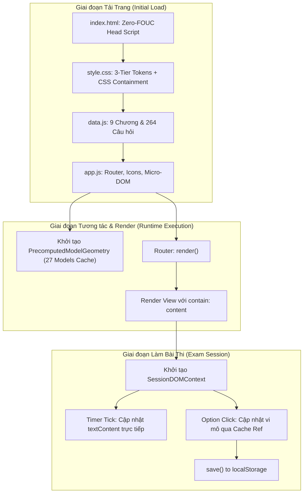

# Data Model & Performance Entities: NetStudy Performance Optimization

**Feature**: `specs/003-performance-optimization`
**Date**: 2026-11-04
**Status**: Completed

---

## 1. Tổng quan Mô hình Thực thể Hiệu năng

Feature 003 không thay đổi cấu trúc dữ liệu học tập cốt lõi (9 chương, 264 câu hỏi, 278 thuật ngữ) và cấu trúc `localStorage` (`netstudy-atmmt-v1`, `netstudy-theme`). Tài liệu này định nghĩa các thực thể và cấu trúc bộ đệm (cache structures) phục vụ cho việc đo đạc, kiểm soát ngân sách hiệu năng và tối ưu hóa kết xuất tại runtime.

---

## 2. Các Thực thể Hiệu năng & Cấu trúc Dữ liệu Runtime

### A. Thực thể `PerformanceMetricRecord`
Đại diện cho chỉ số đo đạc hiệu năng trước và sau tối ưu:

```typescript
interface PerformanceMetricRecord {
  id: string;                      // Ví dụ: 'METRIC-LCP', 'METRIC-CLS', 'METRIC-RENDER-ROUTE'
  name: string;                    // Tên chỉ số: 'Largest Contentful Paint', 'Cumulative Layout Shift', v.v.
  category: 'core-web-vitals' | 'runtime-latency' | 'payload-size' | 'dom-overhead';
  unit: 'ms' | 'score' | 'bytes' | 'count';
  baselineValue: number;           // Số liệu đo đạc thực tế trước khi tối ưu
  targetValue: number;             // Mục tiêu kỹ thuật cần đạt được
  measuredValue?: number;          // Kết quả đo đạc thực tế sau tối ưu
  environment: 'node-headless-vm' | 'browser-devtools' | 'lighthouse-lab';
  status: 'pending' | 'achieved' | 'missed';
}
```

### B. Bảng Chỉ số Cơ sở (Baseline) vs Mục tiêu (Target)

| ID | Chỉ số Hiệu năng | Đơn vị | Số liệu Cơ sở (Baseline) | Mục tiêu Feature 003 (Target) | Môi trường Đo đạc |
|:---|:---|:---:|:---:|:---:|:---:|
| `M-PAYLOAD` | Tổng dung lượng uncompressed | bytes | $720,800$ ($703.9\text{ KB}$) | $\le 725,000$ (Kiểm soát tăng) | Kích thước file hệ thống |
| `M-EVAL` | Thời gian nạp & đánh giá JS | ms | $19.42\text{ ms}$ | $\le 18.00\text{ ms}$ | Node.js VM V8 |
| `M-ROUTE` | Thời gian kết xuất 1 Route trung bình | ms | $0.432\text{ ms}$ | $\le 0.350\text{ ms}$ | Node.js Benchmark (100 routes) |
| `M-SVG` | Thời gian dựng 1 sơ đồ SVG Mô hình | ms | $0.054\text{ ms}$ | $\le 0.020\text{ ms}$ | Node.js Benchmark (270 models) |
| `M-CLS` | Cumulative Layout Shift | score | $0.00$ | $0.00$ (Bảo toàn) | Browser DevTools / Lighthouse |
| `M-INP` | Interaction to Next Paint | ms | $<50\text{ ms}$ | $<30\text{ ms}$ | Browser User Interaction |
| `M-REF` | Số lần truy vấn DOM Timer mỗi bài thi | count | $4,500\text{ lần}$ | $1\text{ lần}$ (Cache ref) | Session Runtime |

---

### C. Thực thể `PrecomputedModelGeometry`
Cấu trúc bộ đệm trong bộ nhớ (In-Memory Cache) lưu trữ trước tọa độ và các dòng chữ bẻ dòng cho 27 mô hình an toàn mạng:

```typescript
interface PrecomputedModelGeometry {
  modelId: string;                 // Mã mô hình (ví dụ: '4' cho RSA, '5' cho Diffie-Hellman)
  height: number;                  // Chiều cao tính toán sẵn của khung SVG
  nodeGeometry: Map<string, {      // Tọa độ tính sẵn của từng nút mạng
    id: string;
    x: number;
    y: number;
    titleLines: string[];          // Nhãn tiêu đề đã bẻ dòng sẵn bằng lines(..., 23)
    captionLines: string[];        // Nhãn phụ đề đã bẻ dòng sẵn bằng lines(..., 28)
    titleY: number;                // Tọa độ Y tính sẵn của tiêu đề
    captionY: number;              // Tọa độ Y tính sẵn của phụ đề
  }>;
  edgeGeometry: Array<{            // Đường dẫn hình học tính sẵn của từng mũi tên
    id: string;
    fromId: string;
    toId: string;
    pathD: string;                 // Chuỗi thuộc tính d của <path> (tính 1 lần)
    arrowPoints: string;           // Chuỗi points của <polygon> đầu mũi tên
    labelBox: { x: number; y: number; w: number; h: number };
    labelLines: string[];          // Nhãn mũi tên đã bẻ dòng sẵn bằng lines(..., 16)
  }>;
}
```

**Lợi ích**:
Khi người dùng bấm chuyển giữa các bước 1, 2, 3... hàm `svg(m, index)` chỉ việc tra cứu `PrecomputedModelGeometry`, kiểm tra `active.has(ed.id)` để chọn màu sắc, loại bỏ hoàn toàn các phép toán hình học và xử lý chuỗi lặp đi lặp lại.

---

### D. Thực thể `SessionDOMContext`
Cấu trúc ngữ cảnh runtime tạm thời trong thời gian diễn ra bài thi 75 phút hoặc phiên luyện tập:

```typescript
interface SessionDOMContext {
  activeSessionId: string;
  timerElement: HTMLElement | null;          // Cache tham chiếu #timer
  optionElements: NodeList | null;           // Cache danh sách các nút .option
  qnavButtonElements: Map<number, HTMLElement>; // Cache các nút chuyển câu hỏi
  counterElement: HTMLElement | null;        // Cache thẻ đếm số câu đã trả lời
}
```

**Quy tắc vòng đời (Lifecycle Rules)**:
1. **Khởi tạo (`session()`)**: Khi người dùng vào trang làm bài, tìm kiếm và lưu các tham chiếu DOM vào `SessionDOMContext`.
2. **Sử dụng (`updateTimer()`, `updateOptionSelection()`)**: Tương tác trực tiếp qua tham chiếu cache, loại bỏ `document.querySelector`.
3. **Giải phóng (`submit()`, `go()`)**: Khi nộp bài hoặc rời trang, gán các tham chiếu về `null` để hỗ trợ cơ chế dọn rác (Garbage Collection) của trình duyệt.

---

## 3. Biểu đồ Luồng Xử lý Dữ liệu và Hiệu năng (Performance Data Flow)


