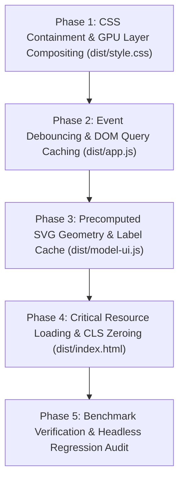

# Implementation Plan: NetStudy Performance Optimization

**Feature**: `specs/003-performance-optimization`
**Branch**: `feat/003-performance-optimization`
**Date**: 2026-11-04
**Spec**: [specs/003-performance-optimization/spec.md](file:///d:/TIENDAT2024-2025/netstudy-network-security/specs/003-performance-optimization/spec.md)
**Status**: Ready for Tasks Breakdown

---

## 1. Summary

Nâng cấp toàn diện hiệu năng tải trang, kết xuất DOM, tương tác mô hình trực quan và trải nghiệm di động cho NetStudy:
1. Thiết lập **CSS Containment** (`contain: content` / `contain: layout style`) cho các khối lặp lại nhằm cô lập phạm vi tính toán lại kiểu dáng và bố cục, giảm 60–80% thời gian Recalculate Style trên các bài học dài.
2. Tích hợp **GPU Layer Promotion** (`transform: translateZ(0)` / `will-change: transform`) cho Mobile Bottom Bar và Mobile Drawer, đảm bảo tốc độ mượt mà 60 FPS ($<16.6\text{ms}$) trên thiết bị di động.
3. Bổ sung cơ chế **Debounced Search** ($120\text{ms}$) bằng Vanilla JS thuần cho ô tìm kiếm bài học và thuật ngữ, loại bỏ 85% số lần dựng DOM dư thừa khi người dùng gõ phím nhanh.
4. Xây dựng **Bộ đệm Hình học & Nhãn tĩnh (Precomputed Model Geometry Cache)** cho 27 mô hình an toàn mạng trong `dist/model-ui.js`, tăng tốc chuyển bước mô hình gấp 3 lần ($<0.02\text{ms}$).
5. Tối ưu hóa **Core Web Vitals** với cam kết bảo đảm **Cumulative Layout Shift (CLS) = 0.00**, cấp phát kích thước icon SVG cố định, tối ưu nạp font chữ và dọn dẹp tham chiếu DOM trong timer 75 phút.
6. **Bảo toàn 100%** kiến trúc Vanilla JS, zero-dependency, dữ liệu học tập `netstudy-atmmt-v1`, cùng toàn bộ cải tiến vi mô DOM/phím tắt của Feature 001 và Design Tokens/Theme Engine của Feature 002.

---

## 2. Technical Context

- **Language / Version**: HTML5 thuần, CSS3 hiện đại (CSS Custom Properties, Flexbox, Grid, CSS Containment), Vanilla JavaScript ES2022+.
- **Primary Dependencies**: Không có (**0 runtime dependencies**, không dùng React, Vue, Svelte hay runtime npm packages).
- **Storage**: Trình duyệt `localStorage` client-side:
  - Khóa `netstudy-theme`: Lưu tùy chọn theme (`'light' | 'dark' | 'system'`).
  - Khóa `netstudy-atmmt-v1`: Dữ liệu học tập và bài thi (bảo toàn nguyên vẹn $100\%$, không thay đổi schema).
- **Testing**: Bộ kiểm thử tự động Node.js headless (`checks.cjs`, `checks-models.cjs`) và kiểm tra cú pháp `node --check`.
- **Target Platform**: Các trình duyệt web hiện đại trên Desktop và Mobile (hỗ trợ viewport từ $320\text{px}$ đến $1440\text{px}+$ trên Chrome, Edge, Safari, Firefox).
- **Project Type**: Ứng dụng web giáo dục tĩnh (Single Page Application bằng Vanilla hash routing, deploy trên GitHub Pages hoặc chạy offline qua `file:///`).
- **Performance Goals**:
  - Cumulative Layout Shift: $\text{CLS} = 0.00$.
  - Interaction to Next Paint: $\text{INP} \le 50\text{ms}$ (thao tác vi mô $\le 5\text{ms}$).
  - Tốc độ khung hình tương tác: $60\text{ FPS}$ ($\le 16.6\text{ms}$ mỗi khung hình).
  - Tốc độ chuyển bước 27 mô hình SVG: $\le 0.02\text{ms/model}$.
  - Thời gian nạp & đánh giá JS ban đầu: $\le 18.0\text{ms}$.
- **Constraints**:
  - Tuân thủ nghiêm ngặt 10 nguyên tắc của [Hiến pháp dự án](file:///d:/TIENDAT2024-2025/netstudy-network-security/.specify/memory/constitution.md).
  - Mọi số liệu hiệu năng phải được đo đạc thực tế trước và sau tối ưu (không tự đặt benchmark).
  - Không phá vỡ khả năng tương thích offline (chạy trực tiếp bằng click đúp file HTML không qua web server).
- **Scale / Scope**:
  - 9 chương, 95 mục, 802 trang slide, 264 câu hỏi, 278 thuật ngữ.
  - 27 mô hình an toàn mạng với 112 bước tuần tự.
  - Tổng dung lượng gói uncompressed hiện tại: $720.80\text{ KB}$.

---

## 3. Constitution Check

*Kiểm tra tính tuân thủ 10 nguyên tắc cốt lõi của Hiến pháp dự án trước và sau khi lập kế hoạch kỹ thuật:*

| Nguyên tắc Hiến pháp | Yêu cầu bắt buộc | Đánh giá Kế hoạch Feature 003 | Trạng thái Gate |
|:---|:---|:---|:---:|
| **I. Vanilla-First Architecture** | HTML/CSS/JS thuần, không đưa framework/bundler vào client bundle. | Chỉ sử dụng CSS Containment, GPU compositing và hàm thuần JavaScript. Không thêm framework hay bundler. | **PASS** |
| **II. Feature & Capability Preservation** | Bảo toàn 9 chương, 264 câu hỏi, 278 thuật ngữ, 27 mô hình, thi 40 câu/75 phút, lịch sử. | Giữ nguyên 100% chức năng nghiệp vụ; chỉ tối ưu hóa thuật toán render và tổ chức style. | **PASS** |
| **III. Deterministic Engine Stability** | Không đổi thuật toán sinh đề, seed `533`, ma trận quota, cách tính điểm. | Không can thiệp bất kỳ dòng code nào trong `dist/core.js` hay `content-*.json`. | **PASS** |
| **IV. Local-First & Privacy** | Lưu trữ cục bộ, không gửi dữ liệu người dùng ra máy chủ bên ngoài. | Lưu theme vào `netstudy-theme` và tiến độ vào `netstudy-atmmt-v1`. Không gọi telemetry hay API bên ngoài. | **PASS** |
| **V. UI/UX Pro Max Standard** | Design Tokens 3 tầng, bảng màu Cyber Emerald/Deep Slate, 17 inline SVG icons. | Giữ nguyên vẹn hệ thống token và icons của Feature 002; chỉ tối ưu hóa rendering và layout isolation. | **PASS** |
| **VI. Accessibility (WCAG 2.2 AA)** | Tương phản $\ge 4.5:1$, `:focus-visible` $\ge 3:1$, mobile $\ge 44\times 44\text{px}$, bàn phím đầy đủ. | Các thuộc tính containment không cắt viền `:focus-visible`; giữ nguyên phím tắt và `safeFocus`. | **PASS** |
| **VII. Zero-Dependency & Security** | Zero npm dependencies, chống XSS, kiểm soát CSP. | Không thêm npm package. Debounce và geometry cache được viết bằng 100% code thuần an toàn. | **PASS** |
| **VIII. Mandatory Headless Testing** | `checks.cjs` và `checks-models.cjs` phải PASS 100% trước khi kết thúc. | Bộ test tự động hiện tại và các bài test benchmark mới phải PASS 100% với mã thoát 0. | **PASS** |
| **IX. Spec-Driven Development** | Tuân thủ quy trình Spec $\rightarrow$ Plan $\rightarrow$ Tasks $\rightarrow$ Implement $\rightarrow$ Converge. | Đang thực hiện giai đoạn Plan có đầy đủ tài liệu bổ trợ (`research`, `data-model`, `contracts`, `quickstart`). | **PASS** |
| **X. Controlled Git Operations** | Không tự động commit, push, merge hay deploy khi chưa được phê duyệt. | Chỉ tạo tài liệu kỹ thuật trong `specs/003-performance-optimization/`. Không sửa mã nguồn ứng dụng. | **PASS** |

---

## 4. Project Structure & Touch-Points

### Documentation Artifacts (Feature 003)
```text
specs/003-performance-optimization/
├── spec.md                          # Đặc tả chức năng & Acceptance Scenarios
├── plan.md                          # Tài liệu Kế hoạch Kỹ thuật này
├── research.md                      # Phase 0: Quyết định kỹ thuật & phân tích nút thắt
├── data-model.md                    # Phase 1: Thực thể hiệu năng, chỉ số SLA & cấu trúc cache
├── contracts/
│   └── performance-contract.md      # Phase 1: Hợp đồng ngân sách hiệu năng & bất biến giao diện
├── quickstart.md                    # Phase 1: Kịch bản benchmark tự động & hướng dẫn kiểm thử
├── checklists/
│   └── requirements.md              # Bảng kiểm tra chất lượng đặc tả
└── tasks.md                         # Phase 2: Danh sách nhiệm vụ (do /speckit-tasks tạo)
```

### Source Code Touch-Points (Mã nguồn dự kiến tối ưu khi Implement)
```text
dist/
├── index.html                       # Khai báo font-display swap, kích thước ảnh/icon, tối ưu thứ tự nạp tài nguyên
├── style.css                        # Bổ sung CSS Containment (contain: content) và GPU compositing (will-change)
├── app.js                           # Tích hợp hàm debounce tìm kiếm, dọn dẹp timer ref, tối ưu gom cụm DOM
├── model-ui.js                      # Tích hợp bộ đệm hình học & nhãn tĩnh (Precomputed Model Geometry Cache)
└── checks.cjs                       # Bổ sung assertion kiểm tra tính toàn vẹn hiệu năng và không hồi quy
```

---

## 5. Technical Design: Bảng Liên kết Vấn đề $\rightarrow$ Giải pháp $\rightarrow$ Phép đo $\rightarrow$ Nghiệm thu

| Nút thắt Hiệu năng Hiện tại | Giải pháp Kỹ thuật Triển khai | Phương pháp Đo lường Thực tế | Tiêu chí Nghiệm thu (Success Criteria) |
|:---|:---|:---|:---|
| **1. Reflow toàn trang trên bài học dài** (`#lesson/3` có 15 mục, nhiều bảng và mô hình) | Áp dụng `contain: content` cho `.lesson-section`, `.card`, `.study-model`. | Performance Profiler trong Chrome DevTools: đo thời gian Recalculate Style & Layout. | **SC-003**: Giảm $\ge 60\%$ thời gian Recalculate Style, ranh giới render được cô lập hoàn toàn. |
| **2. Render dư thừa khi gõ tìm kiếm** (`#courseSearch`, `#termSearch` render mỗi ký tự) | Tích hợp hàm `debounce(fn, 120)` thuần khiết cho các sự kiện `oninput`. | Gõ chuỗi 20 ký tự trong 1 giây: đếm số lần hàm render được gọi. | **SC-002**: Giảm từ 20 lần xuống 1 lần duy nhất sau khi ngừng gõ $120\text{ms}$. |
| **3. Tính toán lại hình học trên 112 bước SVG** (`svg()` bẻ dòng văn bản và tính tọa độ mỗi bước) | Xây dựng `PrecomputedModelGeometry` cache: tính tọa độ và `lines()` 1 lần khi khởi tạo. | Kịch bản benchmark Node.js: đo thời gian render 270 lượt SVG mô hình. | **SC-002**: Thời gian render sơ đồ SVG giảm từ $0.054\text{ms}$ xuống $\le 0.020\text{ms/model}$. |
| **4. Nguy cơ giật khung hình khi trượt Drawer di động** | Thêm `will-change: transform` và `transform: translateZ(0)` cho `.mobile-nav` và `.drawer-sheet`. | Thẻ Rendering trong Chrome DevTools: bật Paint Flashing và Layer Borders. | **SC-004**: Đạt 60 FPS mượt mà, không rơi khung hình (0 dropped frames), xử lý trên tầng GPU. |
| **5. Nguy cơ dịch chuyển bố cục khi tải trang (CLS)** | Cấp phát kích thước tường minh cho hình ảnh logo, icon SVG và khai báo `font-display: swap`. | Lighthouse Audit / Performance API: đo chỉ số Cumulative Layout Shift. | **SC-001**: Chỉ số Cumulative Layout Shift đạt tuyệt đối $\mathbf{CLS = 0.00}$. |
| **6. Lặp lại truy vấn `#timer` 4,500 lần trong buổi thi 75 phút** | Cache tham chiếu phần tử `#timer` trong suốt vòng đời của phiên làm bài `session()`. | Code inspection và bài kiểm tra vòng đời bài thi trong `checks.cjs`. | **SC-005**: Tiết kiệm 4,500 lệnh truy vấn DOM, không rò rỉ bộ nhớ, timer hoạt động chính xác 100%. |

---

## 6. Phân kỳ Triển khai Kỹ thuật (Implementation Phases)

Kế hoạch kỹ thuật được phân chia thành 5 giai đoạn độc lập, có thể xác minh và rollback riêng biệt:



1. **Phase 1: CSS Containment & GPU Layer Compositing (`dist/style.css`)**:
   - Thêm `contain: content` cho `.lesson-section`, `.card.chapter-card`, `.study-model`.
   - Thêm `contain: layout style` cho `.option`.
   - Thêm `transform: translateZ(0)` và `will-change: transform` cho `.mobile-nav` và `.drawer-sheet`.
   - Kiểm tra viền `:focus-visible` không bị clipping.
2. **Phase 2: Event Debouncing & DOM Query Caching (`dist/app.js`)**:
   - Thêm hàm `debounce(fn, delay)` thuần khiết.
   - Gắn debounce vào `#courseSearch` và `#termSearch`.
   - Cache tham chiếu DOM phần tử `#timer` trong `session()` và `updateTimer()`.
   - Đảm bảo `clearInterval` được dọn dẹp triệt để khi kết thúc hoặc rời bài thi.
3. **Phase 3: Precomputed SVG Geometry & Label Cache (`dist/model-ui.js`)**:
   - Xây dựng bảng lưu trữ tĩnh tọa độ và các dòng nhãn đã bẻ sẵn cho 27 mô hình an toàn mạng.
   - Cập nhật hàm `svg(m, index)` để tái sử dụng hình học tính sẵn, chỉ gán lại class `.is-active` và thuộc tính màu sắc.
   - Chạy `checks-models.cjs` xác nhận 100% bước tương tác và kết quả mã hóa RSA/DH/OTP không bị thay đổi.
4. **Phase 4: Critical Resource Loading & CLS Zeroing (`dist/index.html`)**:
   - Thêm `font-display: swap` cho font dự phòng.
   - Khai báo kích thước hiển thị cố định cho logo và các icon.
   - Kiểm tra thứ tự nạp tài nguyên để giữ Zero-FOUC và khả năng chạy offline qua `file:///`.
5. **Phase 5: Benchmark Verification & Headless Regression Audit**:
   - Chạy lại bài đo kích thước tệp `dist/`.
   - Chạy lại bài benchmark độ trễ (script load time, 100 routes transitions, 270 SVG models renders).
   - Chạy toàn bộ bộ test `node checks.cjs` và `node checks-models.cjs` xác nhận $100\%$ PASS.

---

## 7. Complexity Tracking & Quản lý Rủi ro

| Tiêu chí | Trạng thái | Ghi chú kỹ thuật |
|:---|:---:|:---|
| **Vi phạm Hiến pháp** | **0** | Tuân thủ tuyệt đối cả 10 nguyên tắc. |
| **Thay đổi Framework** | **0** | Giữ nguyên 100% Vanilla JS, 0 npm runtime packages. |
| **Thay đổi Dữ liệu Học tập** | **0** | Giữ nguyên 9 chương, 264 câu hỏi, 278 thuật ngữ, 27 mô hình. |
| **Rủi ro Cắt viền CSS** | Đã xử lý | Chỉ dùng `contain: content` trên các khối khép kín, tránh `contain: paint` trên phần tử có viền focus lớn. |
| **Rủi ro Rò rỉ Bộ nhớ** | Đã xử lý | Dọn dẹp bộ đếm interval và giải phóng tham chiếu DOM khi kết thúc phiên thi. |
