# Tasks: NetStudy Performance Optimization

**Input**: Design documents from `specs/003-performance-optimization/` (`spec.md`, `plan.md`, `research.md`, `data-model.md`, `contracts/performance-contract.md`, `quickstart.md`)
**Prerequisites**: `spec.md`, `plan.md`, `constitution.md` (v1.0.0 ratified)
**Organization**: Tasks are grouped by foundational phase, user stories (US1 through US4), and performance engineering areas (Phases A through F) to enable incremental, independently verifiable delivery.

---

## Task Format Reference
`- [ ] [TaskID] [P?] [Story?] Description with file path`
- **[P]**: Parallelizable (different files, no shared state conflicts)
- **[Story]**: Mapped User Story (`[US1]`, `[US2]`, `[US3]`, `[US4]`)
- Each task includes explicit: **Dependencies**, **Acceptance Criteria**, **Verification Method**, and **Baseline to Compare** (for optimization tasks).

---

## Phase 1: Setup & Baseline Profiling (Nhóm A — Baseline & Profiling)

**Purpose**: Establish a repeatable, automated benchmark harness and capture empirical baseline metrics across all performance vectors before touching application code.

- [X] T001 Execute automated baseline benchmark runner to record current file sizes, script evaluation times, and route latencies
  - **File**: `specs/003-performance-optimization/quickstart.md`
  - **Dependencies**: None
  - **Acceptance Criteria**: Record baseline: Total payload = 720,800 bytes (703.91 KB), Script eval = 19.42 ms, 100 route renders = 0.432 ms/render, 270 model SVG renders = 0.054 ms/model.
  - **Verification Method**: Run benchmark script in `quickstart.md` and verify all metrics logged.
  - **Baseline to Compare**: Pre-optimization measurements recorded in `spec.md` Section 1.

- [X] T002 [P] Audit CSS file size, selectors, and layout recalculation triggers in `dist/style.css`
  - **File**: `dist/style.css`
  - **Dependencies**: None
  - **Acceptance Criteria**: Catalog all large layout containers (`.hero`, `.lesson-section`, `.card`, `.option`, `.study-model`) for CSS containment eligibility.
  - **Verification Method**: Inspect element styles and measure `dist/style.css` byte length (baseline: 22,129 bytes).

- [X] T003 Profile baseline memory footprint and timer event loop behavior across 75-minute exam simulation
  - **File**: `checks.cjs`, `dist/app.js`
  - **Dependencies**: None
  - **Acceptance Criteria**: Verify timer interval executes once per second without memory accumulation or orphaned listeners.
  - **Verification Method**: Execute headless 75-minute exam simulation via `node checks.cjs`.

---

## Phase 2: Foundational Infrastructure (Nhóm A & C)

**Purpose**: Core infrastructure and reusable utility functions required across multiple optimization areas.

- [X] T004 Create dedicated automated performance benchmark test runner in `checks-perf.cjs`
  - **File**: `checks-perf.cjs`
  - **Dependencies**: T001
  - **Acceptance Criteria**: Automated test script asserts script evaluation $\le 20.0\text{ms}$, 100 route renders $\le 0.45\text{ms/render}$, and 270 model SVG renders $\le 0.06\text{ms/model}$ with exit code 0.
  - **Verification Method**: `node checks-perf.cjs`
  - **Baseline to Compare**: Baseline execution times (19.42 ms load, 0.432 ms route, 0.054 ms model).

- [X] T005 [P] Implement pure, zero-dependency debounce utility in `dist/app.js`
  - **File**: `dist/app.js`
  - **Dependencies**: None
  - **Acceptance Criteria**: Implement `function debounce(fn, delay = 120)` with zero npm dependencies per `contracts/performance-contract.md`.
  - **Verification Method**: `node --check dist/app.js` and unit test debounce timing in `checks.cjs`.

**Checkpoint**: Foundational benchmark runner and utilities ready — User Story optimizations can begin.

---

## Phase 3: User Story 1 - Core Web Vitals & Static Asset Optimization (Priority: P1) 🎯 MVP (Nhóm D — CSS & Static Assets)

**Goal**: Eliminate Cumulative Layout Shift (CLS = 0.00), optimize font loading with `font-display: swap`, and ensure instant First Contentful Paint without render-blocking overhead.
**Independent Test**: Load `#home` and `#courses`: LCP $\le 1.2\text{s}$, CLS $= 0.00$, no layout shifts when icons or fonts load, all tests pass.

- [X] T006 [US1] Declare explicit SVG icon and logo dimensions in `dist/index.html` and `dist/style.css`
  - **File**: `dist/index.html`, `dist/style.css`
  - **Dependencies**: T004
  - **Acceptance Criteria**: Ensure all `.svg-icon`, brand logo (`.logo`), and `.shield` elements have explicit width/height attributes or CSS aspect-ratios, eliminating layout shift.
  - **Verification Method**: Inspect element bounding client rects before and after load; verify CLS = 0.00.
  - **Baseline to Compare**: Baseline CLS = 0.00 (bảo toàn).

- [X] T007 [P] [US1] Add `font-display: swap` and fallback metric hints for typography in `dist/style.css`
  - **File**: `dist/style.css`
  - **Dependencies**: T002
  - **Acceptance Criteria**: Ensure font stack `--font-sans` renders system fallback immediately to prevent Flash of Invisible Text (FOIT) on slow networks.
  - **Verification Method**: Inspect computed font styles and test in DevTools with network throttling.

- [X] T008 [US1] Optimize script loading attributes in `dist/index.html` while preserving offline `file:///` compatibility
  - **File**: `dist/index.html`
  - **Dependencies**: T006
  - **Acceptance Criteria**: Structure script tags to preserve synchronous Zero-FOUC execution in `<head>` while maintaining $100\%$ offline file execution without CORS errors.
  - **Verification Method**: Open `dist/index.html` directly in browser via `file:///` protocol and verify zero console errors.

- [X] T009 [US1] Validate Core Web Vitals targets against Quickstart Scenario A
  - **File**: `specs/003-performance-optimization/quickstart.md`
  - **Dependencies**: T006, T007, T008
  - **Acceptance Criteria**: Verify CLS = 0.00 and FCP $\le 0.8\text{s}$ under Quickstart Scenario A criteria.
  - **Verification Method**: Execute Lighthouse audit profile or automated metrics script.

**Checkpoint**: User Story 1 complete — MVP Core Web Vitals achieved.

---

## Phase 4: User Story 2 - DOM Rendering & Layout Recalculation Isolation (Priority: P1) (Nhóm B — DOM Rendering)

**Goal**: Isolate style and layout recalculation boundaries using CSS Containment and eliminate redundant DOM re-renders during search and lesson viewing.
**Independent Test**: Open `#lesson/3` (15 sections, comparison tables, models) and `#terms`: Scrolling is locked at 60 FPS, searching does not drop frames, style recalculation is scoped to individual cards.

- [X] T010 [US2] Apply CSS Containment (`contain: content`) to `.lesson-section`, `.card.chapter-card`, and `.study-model` in `dist/style.css`
  - **File**: `dist/style.css`
  - **Dependencies**: T002
  - **Acceptance Criteria**: Declare `contain: content` on closed card containers, scoping browser layout and style recalculations without clipping `:focus-visible` outlines.
  - **Verification Method**: Inspect computed style in browser and verify `node checks.cjs` passes.
  - **Baseline to Compare**: Uncontained full-tree layout reflow on `#lesson/3`.

- [X] T011 [P] [US2] Apply CSS Containment (`contain: layout style`) to quiz options `.option` in `dist/style.css`
  - **File**: `dist/style.css`
  - **Dependencies**: T002
  - **Acceptance Criteria**: Declare `contain: layout style` on `.option`, preventing option hover/selected state changes from triggering sibling reflows.
  - **Verification Method**: Check option click rendering latency in `#session`.

- [X] T012 [US2] Integrate debounced search handler ($120\text{ms}$) for `#courseSearch` and `#termSearch` in `dist/app.js`
  - **File**: `dist/app.js`
  - **Dependencies**: T005
  - **Acceptance Criteria**: Wrap search filtering in `debounce(..., 120)`, reducing DOM re-renders by $\ge 80\%$ during continuous typing.
  - **Verification Method**: Type 20 characters into `#termSearch`; verify render executes once after typing stops.
  - **Baseline to Compare**: 1 full DOM re-render per keystroke (20 re-renders for 20 chars).

- [X] T013 [US2] Cache active DOM element references (`timerEl`, `counterEl`) during exam session in `dist/app.js`
  - **File**: `dist/app.js`
  - **Dependencies**: T005
  - **Acceptance Criteria**: Store `#timer` reference in `SessionDOMContext` when starting `#session`, eliminating 4,500 `document.querySelector` calls per 75-minute exam.
  - **Verification Method**: Run 40-question exam simulation via `node checks.cjs`.
  - **Baseline to Compare**: 1 `querySelector('#timer')` per second (4,500 calls/session).

- [X] T014 [US2] Optimize question review list string concatenation in `dist/app.js`
  - **File**: `dist/app.js`
  - **Dependencies**: T013
  - **Acceptance Criteria**: Streamline HTML template assembly for `#result` and `#review` lists to minimize intermediate memory allocations.
  - **Verification Method**: Measure render time of 40-question result view with `node checks-perf.cjs`.

**Checkpoint**: User Stories 1 AND 2 complete — Fast, contained DOM rendering operational.

---

## Phase 5: User Story 3 - Interactive SVG Models Optimization (Priority: P2) (Nhóm E — Interactive Models)

**Goal**: Pre-cache static geometry and word-wrapped label lines for all 27 security mechanism models, reducing step transition latency by $3\times$ ($<0.02\text{ms/model}$).
**Independent Test**: Navigate to `#models/4` (RSA) and `#models/5` (Diffie-Hellman), click through all steps: latency $\le 0.02\text{ms/model}$, 60 FPS, all 112 step highlights and numeric values verified.

- [X] T015 [US3] Build static geometry and line-wrap label pre-cache for 27 security models in `dist/model-ui.js`
  - **File**: `dist/model-ui.js`
  - **Dependencies**: T004
  - **Acceptance Criteria**: Precompute `lines()` word-wrapping and node `[x, y]` coordinates once during initialization into `PrecomputedModelGeometry` cache per `data-model.md`.
  - **Verification Method**: Inspect cache data structure in `node -e "require('./dist/model-ui.js')"` test.
  - **Baseline to Compare**: 1 `lines()` call per node/edge on every step transition.

- [X] T016 [US3] Refactor `ModelUI.svg()` to consume precomputed geometry cache in `dist/model-ui.js`
  - **File**: `dist/model-ui.js`
  - **Dependencies**: T015
  - **Acceptance Criteria**: Update `svg(m, index)` to generate SVG strings from cached geometry, only computing active edges and hot nodes for the target step.
  - **Verification Method**: Run `node checks-models.cjs` and verify 27 models, 112 steps pass with exit code 0.
  - **Baseline to Compare**: Baseline SVG render time = 0.054 ms/model. Target: $\le 0.020\text{ ms/model}$.

- [X] T017 [US3] Optimize active edge/node class toggling during step navigation (`selectStep`) in `dist/model-ui.js`
  - **File**: `dist/model-ui.js`
  - **Dependencies**: T016
  - **Acceptance Criteria**: Streamline DOM replacement in `.model-diagram` and focus preservation on `.model-step` button without layout thrashing.
  - **Verification Method**: Test step switching in `#models/4` and `#models/12` under Quickstart Scenario D.

- [X] T018 [US3] Verify numeric precision and step accuracy across all 27 models and 112 steps with `checks-models.cjs`
  - **File**: `checks-models.cjs`
  - **Dependencies**: T016, T017
  - **Acceptance Criteria**: Confirm 100% PASS on RSA modulo, Diffie-Hellman color exponentiation, OTP XOR, and all step descriptions.
  - **Verification Method**: `node checks-models.cjs` exits with code 0.

**Checkpoint**: User Stories 1, 2, and 3 complete — High-performance SVG interactive models active.

---

## Phase 6: User Story 4 - Mobile Hardware Acceleration & Energy Efficiency (Priority: P2) (Nhóm C — JavaScript Optimization & Mobile)

**Goal**: Deliver smooth 60 FPS mobile navigation via GPU Compositing and eliminate memory leaks during extended exam sessions.
**Independent Test**: Open mobile viewport ($375\text{px}$), toggle drawer and scroll: 60 FPS, zero dropped frames, heap memory stable over 75-minute exam simulation.

- [X] T019 [US4] Promote `.mobile-nav` to dedicated GPU compositor layer with `transform: translateZ(0)` in `dist/style.css`
  - **File**: `dist/style.css`
  - **Dependencies**: T002
  - **Acceptance Criteria**: Add hardware acceleration to `.mobile-nav` to eliminate CPU repaints during page scrolling on mobile devices.
  - **Verification Method**: Inspect compositor layers in DevTools Rendering panel.

- [X] T020 [P] [US4] Promote `.drawer-sheet` to GPU layer with `will-change: transform` and `transform: translateZ(0)` in `dist/style.css`
  - **File**: `dist/style.css`
  - **Dependencies**: T002
  - **Acceptance Criteria**: Add `will-change: transform` and `transform: translateZ(0)` to `.drawer-sheet` for 60 FPS slide-in animation.
  - **Verification Method**: Toggle mobile drawer in DevTools Device Mode; verify 0 paint flashing.

- [X] T021 [US4] Implement strict timer cleanup and interval disposal on exam completion in `dist/app.js`
  - **File**: `dist/app.js`
  - **Dependencies**: T013
  - **Acceptance Criteria**: Ensure `clearInterval(tick)` is invoked on exam submit, route exit, and reload, setting `tick = null` to prevent orphaned timer callbacks.
  - **Verification Method**: Test exam completion and navigation away via `checks.cjs`.

- [X] T022 [US4] Verify 60 FPS mobile animation and zero paint flashing against Quickstart Scenario E
  - **File**: `specs/003-performance-optimization/quickstart.md`
  - **Dependencies**: T019, T020, T021
  - **Acceptance Criteria**: Confirm mobile drawer slide-up and bottom navigation transitions operate on GPU thread without dropped frames.
  - **Verification Method**: Execute Quickstart Scenario E validation.

**Checkpoint**: All 4 User Stories complete — Full Performance Optimization implemented.

---

## Phase 7: Polish, Regression & Post-Optimization Benchmark (Nhóm F — Regression & Benchmark)

**Purpose**: Cross-cutting benchmark comparison, automated test suite execution, and comprehensive regression verification against all baseline metrics.

- [X] T023 Re-run automated benchmark suite in `checks-perf.cjs` and verify all target SLA metrics achieved
  - **File**: `checks-perf.cjs`
  - **Dependencies**: T009, T014, T018, T022
  - **Acceptance Criteria**: Script eval $\le 18.0\text{ms}$, 100 routes $\le 0.350\text{ms/render}$, 270 model SVGs $\le 0.020\text{ms/model}$.
  - **Verification Method**: `node checks-perf.cjs`
  - **Baseline to Compare**: Pre-optimization baseline: 19.42 ms load, 0.432 ms route, 0.054 ms model.

- [X] T024 [P] Verify Feature 001 invariants (targeted DOM updates, keyboard shortcuts, `safeFocus`, natural scroll) in `checks.cjs`
  - **File**: `checks.cjs`
  - **Dependencies**: T013, T021
  - **Acceptance Criteria**: Confirm answer selection, flag toggling, section completion, bookmarking, and keyboard keys `1-4`, `A-D`, `F`, `ArrowRight`/`ArrowLeft` continue to execute in-place without full re-render.
  - **Verification Method**: `node checks.cjs` passes 100%.

- [X] T025 [P] Verify Feature 002 invariants (3-tier design tokens, Light/Dark/System theme, Zero-FOUC, 17 SVG icons) in `checks.cjs`
  - **File**: `checks.cjs`
  - **Dependencies**: T006, T010
  - **Acceptance Criteria**: Confirm theme cycling (`system` $\leftrightarrow$ `light` $\leftrightarrow$ `dark`), `localStorage['netstudy-theme']` isolation, and 17 inline SVG icons pass all assertions.
  - **Verification Method**: `node checks.cjs` passes 100%.

- [X] T026 Execute complete JavaScript syntax verification across all distribution files
  - **File**: `dist/app.js`, `dist/core.js`, `dist/models.js`, `dist/model-ui.js`
  - **Dependencies**: T014, T016, T021
  - **Acceptance Criteria**: `node --check` passes on all 4 JS distribution files with exit code 0.
  - **Verification Method**: `node --check dist/app.js; node --check dist/core.js; node --check dist/models.js; node --check dist/model-ui.js`

- [X] T027 Execute 27 Models regression test suite with `node checks-models.cjs`
  - **File**: `checks-models.cjs`
  - **Dependencies**: T018
  - **Acceptance Criteria**: Confirm 27 models, 112 steps, click delegation, chapter filter, and cryptographic examples pass with exit code 0.
  - **Verification Method**: `node checks-models.cjs`

- [X] T028 Execute core functional and matrix regression test suite with `node checks.cjs`
  - **File**: `checks.cjs`
  - **Dependencies**: T024, T025
  - **Acceptance Criteria**: Confirm 9 chapters, 95 sections, 264 questions, 100 exam randomizations, and schema validation pass with exit code 0.
  - **Verification Method**: `node checks.cjs`

- [X] T029 Compare and document before/after benchmark results in `specs/003-performance-optimization/quickstart.md`
  - **File**: `specs/003-performance-optimization/quickstart.md`
  - **Dependencies**: T023, T026, T027, T028
  - **Acceptance Criteria**: Record side-by-side table of baseline vs achieved metrics (payload bytes, evaluation ms, route ms, model SVG ms, CLS, INP) in quickstart guide.
  - **Verification Method**: Review `quickstart.md`.

---

## Dependencies & Execution Order

```mermaid
flowchart TD
    subgraph P1 ["Phase 1: Setup & Baseline (Nhóm A)"]
        T001["T001: Record baseline benchmarks"]
        T002["T002: Audit CSS selectors [P]"]
        T003["T003: Profile exam memory & timer"]
    end

    subgraph P2 ["Phase 2: Foundation (Nhóm A & C)"]
        T004["T004: Performance test harness (checks-perf.cjs)"]
        T005["T005: Debounce utility in app.js [P]"]
    end

    subgraph P3 ["Phase 3: User Story 1 (MVP) (Nhóm D)"]
        T006["T006: SVG & logo aspect ratios"]
        T007["T007: Font-display swap [P]"]
        T008["T008: Script loading order in index.html"]
        T009["T009: Core Web Vitals audit (CLS=0)"]
    end

    subgraph P4 ["Phase 4: User Story 2 (Nhóm B)"]
        T010["T010: CSS Containment (content)"]
        T011["T011: CSS Containment (options) [P]"]
        T012["T012: Debounced search (120ms)"]
        T013["T013: Session DOM ref cache (#timer)"]
        T014["T014: Optimize review list DOM"]
    end

    subgraph P5 ["Phase 5: User Story 3 (Nhóm E)"]
        T015["T015: Static geometry pre-cache"]
        T016["T016: Refactor ModelUI.svg() to use cache"]
        T017["T017: Optimize step class toggling"]
        T018["T018: Verify 27 models precision"]
    end

    subgraph P6 ["Phase 6: User Story 4 (Nhóm C)"]
        T019["T019: GPU layer for .mobile-nav"]
        T020["T020: GPU layer for .drawer-sheet [P]"]
        T021["T021: Timer interval cleanup"]
        T022["T022: Verify 60 FPS mobile navigation"]
    end

    subgraph P7 ["Phase 7: Regression & Benchmark (Nhóm F)"]
        T023["T023: Re-run benchmark suite (checks-perf.cjs)"]
        T024["T024: Verify Feature 001 invariants [P]"]
        T025["T025: Verify Feature 002 invariants [P]"]
        T026["T026: Node.js syntax checks"]
        T027["T027: checks-models.cjs execution"]
        T028["T028: checks.cjs execution"]
        T029["T029: Document before/after metrics"]
    end

    P1 --> P2
    P2 --> P3
    P3 --> P4
    P4 --> P5
    P5 --> P6
    P6 --> P7
```

---

## Parallel Execution Opportunities

- **Phase 1**: `T002` (CSS audit) can run in parallel with `T001` and `T003`.
- **Phase 2**: `T005` (Debounce utility in `app.js`) can run in parallel with `T004` (`checks-perf.cjs`).
- **Phase 3**: `T007` (`style.css` font-display) can run in parallel with `T006` and `T008`.
- **Phase 4**: `T011` (`style.css` option containment) can run in parallel with `T010` and `T012`.
- **Phase 6**: `T020` (`style.css` drawer GPU compositing) can run in parallel with `T019`.
- **Phase 7**: `T024` and `T025` (Invariant checks) can run in parallel with `T023` and `T026`.

---

## Implementation Strategy: MVP First

1. **Step 1 (Setup & Foundation)**: Complete Phase 1 and Phase 2. Capture baseline numbers and build the automated benchmark test harness (`checks-perf.cjs`).
2. **Step 2 (MVP Delivery - User Story 1)**: Implement Phase 3. Validate zero layout shift (CLS = 0.00) and smooth font loading on desktop and mobile.
3. **Step 3 (DOM Optimization - User Story 2)**: Implement Phase 4. Apply CSS Containment and search debouncing to isolate recalculation boundaries on long lessons.
4. **Step 4 (SVG Models Optimization - User Story 3)**: Implement Phase 5. Deploy precomputed geometry cache, achieving sub-0.020ms model step transitions.
5. **Step 5 (Mobile Compositing - User Story 4)**: Implement Phase 6. Enable GPU compositing for mobile navigation and verify 60 FPS transitions.
6. **Step 6 (Full Verification & Before/After Audit)**: Complete Phase 7. Run 100% automated test suite, verify zero regression on Feature 001/002, and document verified before/after numbers.
